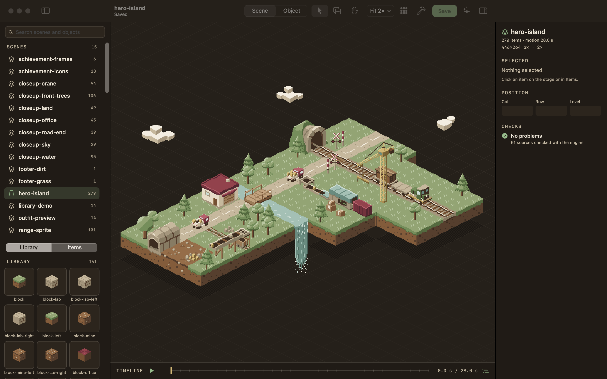
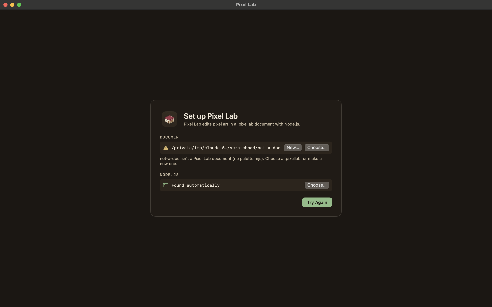
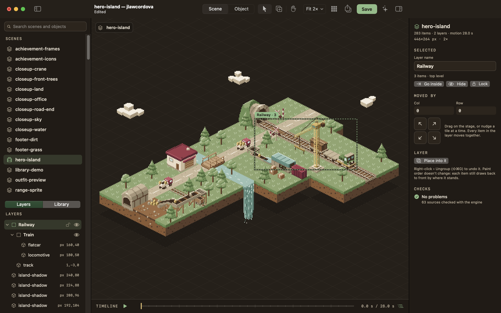
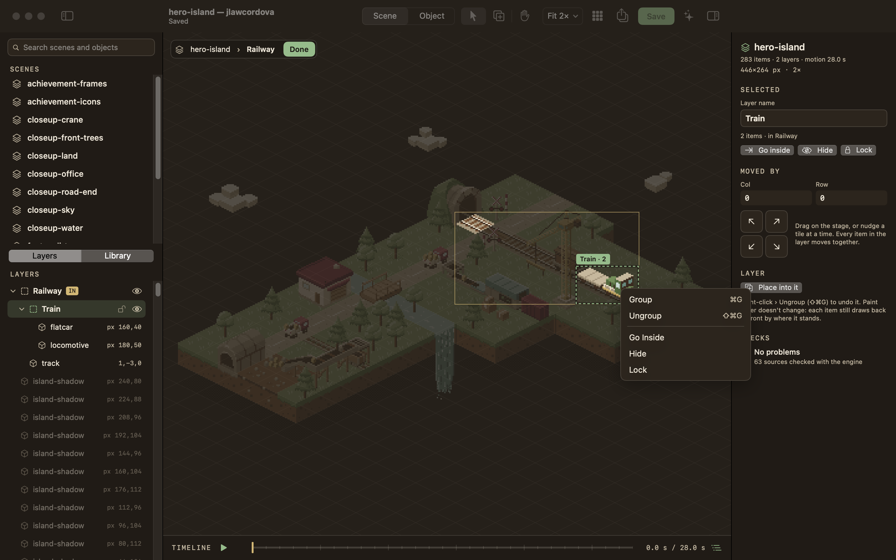
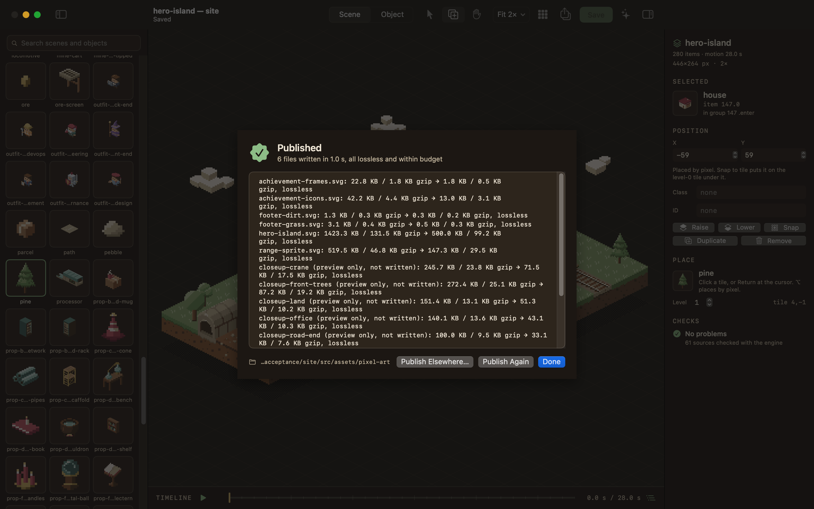
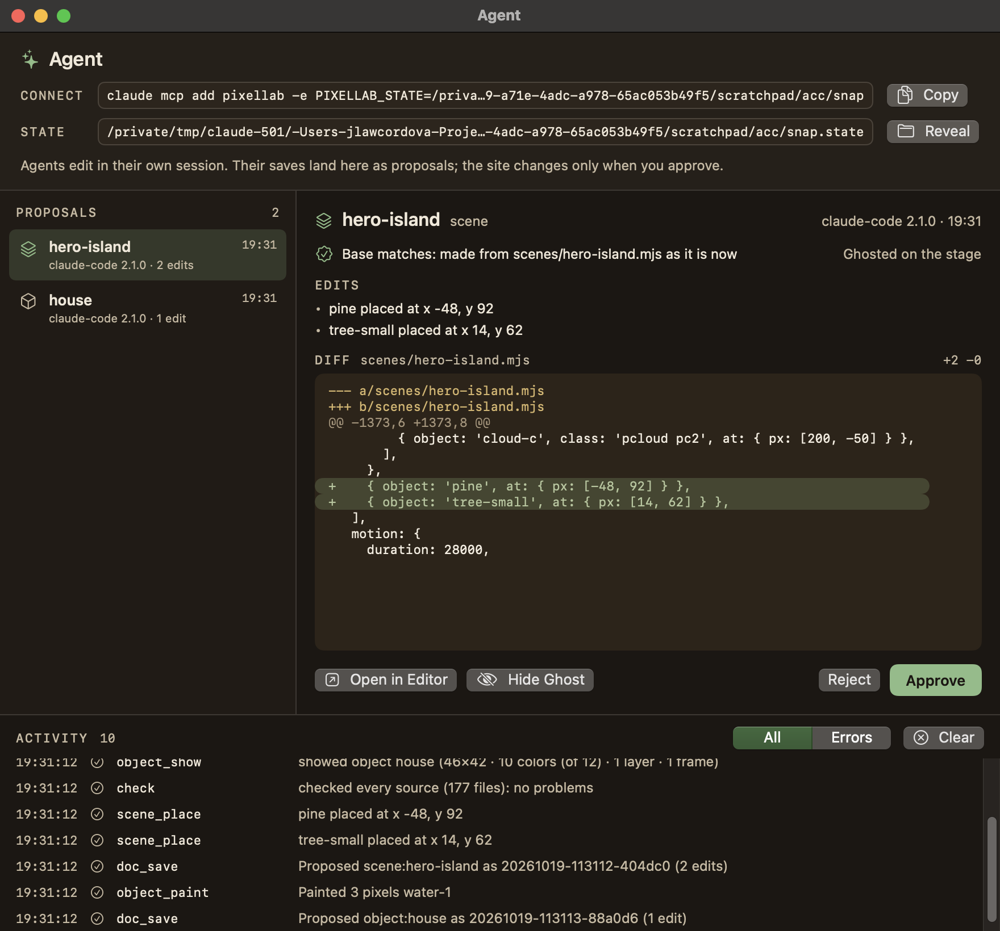

# Pixel Lab for Mac

A native macOS editor for isometric pixel art: the hero island of [jlawcordova.github.io](https://github.com/jlawcordova/jlawcordova.github.io) and its other scenes, and the library objects they're built from. The art lives in a **`.pixellab` document**, a folder you can open, copy and save as like any file; **Publish** compiles it into the SVGs a site inlines.

It's built CLI first: every action is a command in one registry, reachable three ways, so an agent can do everything a person can.

- **Pixel Lab.app**: a SwiftUI app (board 03, "Field notebook", night and day).
- **`pixellab`**: a zero-dependency Node CLI (`pixellab scene place hero-island pine --at 14,6,1`), which is also the pixel-art engine and compiler, exported as the `pixellab` package.
- **`pixellab serve --mcp`**: an MCP server for Claude Code and other agents. Agents' saves become **proposals** you approve in the app.

The document is the source of truth: the engine in this repo validates and serializes every write into the document's `.mjs` sources, and nothing touches a site until you publish. The site keeps its document next to the SVGs it compiles to, and installs this package to check its art.



## Requirements

- macOS 15 or later, Apple silicon or Intel.
- Node.js 22 or later (`node` on your shell's PATH, in `/opt/homebrew/bin` or `/usr/local/bin`, or set in Settings). The app runs its CLI with it; you never type `npm`.
- A `.pixellab` document. With none chosen, Pixel Lab opens the one in `~/Projects/jlawcordova.github.io` when that checkout is there (or its older `source/` folder); File › New Document… makes one anywhere.
- To build: the Xcode Command Line Tools (Swift 6). Full Xcode isn't needed.

## Install

### From a release

Each [release](https://github.com/jlawcordova/jlawcordova-lab/releases) has Pixel Lab.app for Apple silicon as a disk image (`PixelLab-darwin-arm64.dmg`) and a zip of the same app (`PixelLab-darwin-arm64.zip`). Download them from the release page, or with `gh`:

```sh
gh release download --repo jlawcordova/jlawcordova-lab --pattern 'PixelLab-darwin-arm64.dmg' --dir /tmp
```

Open the disk image and drag Pixel Lab to `~/Applications` (create the folder if needed). Then connect Claude Code with the `claude mcp add` command below. The app is ad-hoc signed and the download is quarantined, so the first launch is blocked: allow it under System Settings › Privacy & Security › Open Anyway. To update, quit Pixel Lab and replace the app with the newer one.

On an Intel Mac, install from source.

### From source

```sh
git clone git@github.com:jlawcordova/jlawcordova-lab.git ~/Projects/jlawcordova-lab
cd ~/Projects/jlawcordova-lab
scripts/install.sh
```

`scripts/install.sh` builds `build/Pixel Lab.app` (release build, ad-hoc signed) and copies it to `~/Applications` (it creates the folder if needed; no sudo, never `/Applications`). It ends by printing the `claude mcp add` command and an optional shell alias, both pointing at the CLI inside the installed app:

```sh
claude mcp add pixellab -- node "$HOME/Applications/Pixel Lab.app/Contents/Resources/cli/bin/pixellab.mjs" serve --mcp
alias pixellab='node "$HOME/Applications/Pixel Lab.app/Contents/Resources/cli/bin/pixellab.mjs"'   # in ~/.zshrc
```

Options: `--no-build` installs the existing build, `--dest <dir>` installs somewhere else. Run it again to update; quit Pixel Lab first.

The app is signed ad hoc, not notarized. If macOS won't open it the first time, Control-click it in Finder and choose Open, or allow it in System Settings › Privacy & Security.

## First launch

Pixel Lab opens the document in `~/Projects/jlawcordova.github.io` if that checkout is there, and starts its own `pixellab serve --stdio` server on it. If the document or Node.js can't be found, a setup screen says what's missing, with Choose… for a `.pixellab` (or a site checkout holding one), New… to make one, Choose… for the node binary, and Try Again. Change either later in **Settings** (⌘,), along with the appearance (Auto, Light, Dark). Double-clicking a `.pixellab` in Finder opens it too.

It reopens the last scene or object you had open, else the hero island. The window title shows the open doc and the document's name.



## A short tour

**Scene mode.** The left sidebar lists every scene and, under it, the open scene's **Layers** (the first tab) or the **Library** of objects. The stage draws the scene crisply at Fit or 1×–4× on the 32×16 isometric grid; in the night appearance the hero island's drop shadow takes the page color, as the site's dark theme does. Pick an object in the library and click a tile with the Place tool (⌥-click places by pixel, or drag a thumbnail onto the stage). Click an item to select it; drag it, use the arrow keys, or edit Col, Row and Level (X, Y and Level for pixel-placed items) in the inspector. Duplicate, Remove and Snap to Tile are in the inspector and the Edit menu. Everything undoes. Scenes with motion get a timeline: Play (⌥⌘P) and scrub.

**Depth.** Items draw back to front by where they stand, and you never order them by hand: every edit (placing, moving, setting a field, snapping, duplicating, removing, undo, an approved proposal, a merge) leaves the scene's items in depth order, and the engine draws them in that order whatever the file says, so what's published is right even for a file edited by hand. An item's place in the order comes from a box in tile space: a block's `size`, a sprite's footprint and height, a pixel-placed item's Level. The inspector's **Depth** control (Auto, Front, Back) is the one manual override: Front draws the item over everything else in its list, Back under everything; a group's depth is set from its wrapper line in the inspector. **Level** says how high a pixel-placed item stands, which only matters for depth (its X and Y are still where its foot is drawn). **Footprint**, two steppers in an object's inspector (sprites only), says how many tiles a large sprite covers, so a house or the crane mast sorts against its neighbours by the ground under it. An item with motion takes its place among the others as it moves, so the published SVG draws it once for each place it takes, and the inspector's CHECKS section (and `pixellab check`) lists those copies. A scene whose file isn't in depth order (hand-edited, or made before this change) shows a warning in the CHECKS section with a **Sort** button, or run `pixellab scene sort --all` (add `--dry-run` to see what would move and how many published pixels change).

**Layers.** Name the parts of a scene, and nest them: the Mine, the Railway, the Train inside it. The **Layers** tab shows them as a tree (each layer's layers, then its items, with their tile positions); a scene without layers lists its items at the top level. Select things (⇧-click adds) and Group them (⌘G, or right-click › Group): the new layer, "Group 1", goes under their common parent and is renamed in the inspector. Ungroup (⇧⌘G) moves a layer's contents up a level, where they stay. On the stage a click picks the outermost layer under the pointer (by its pixels, not its box); double-click a layer, or Go Inside, to work inside it: the rest fades, the pill at the top left says where you are (`hero-island › Railway › Train`), clicks pick the next level down, and Done or Esc leaves. Dragging moves everything selected by whole tiles, with the col/row change on its label; the arrow keys and the inspector's nudges do too, and its Moved by fields say how far the layer has gone since you selected it. The eye hides a layer and the lock stops clicks on the stage from picking it (except from inside it); they're kept for each document and scene but never saved in the document or published. Right-click the stage or a row for Group, Ungroup, Go Inside, Hide and Lock. What you place goes into the selected layer, the selected item's layer or the one you're inside (the Library's chip says which), else the top level, and Place into it in a layer's inspector starts placing there. Layers never change draw order or the published SVG: each item still draws back to front by where it stands (see Depth above), and the site's `{ group }` wrappers stay as they are (an item's shows in the inspector as its SVG group).





**Object mode.** Open an object (double-click it in the library, or switch the Scene/Object control with an item selected). Paint with the Pencil, Eraser, Fill and Picker from the palette (the color cap is shown and enforced), switch layers and frames, turn a layer into a frame loop, toggle the onion skin, and watch the preview at 1× and 2× on a tile. File › New Scene… and New Object… make new docs from the engine's starters.

**Checks.** The inspector's CHECKS section validates the open doc with the engine after every edit; a problem that names an item selects it when clicked. Save (⌘S) refuses a doc with problems and explains why, and asks before overwriting a file that changed on disk.

**Changed on disk.** A doc you have open without unsaved edits reloads when its file changes (git, another editor, an approved proposal). One with unsaved edits shows a bar over the stage instead: **Merge** brings the change into your copy and keeps your edits (a three-way merge against the file as you opened it; if you both changed the same lines it says so and changes nothing), **Reload** loads the file and drops your edits (Undo brings them back), **Keep Mine** hides the bar (saving later still asks before it overwrites the file). Approving a proposal for a doc with unsaved edits merges it the same way.

**Publish.** ⌘B or the toolbar's share button compiles every scene that has an `output` into the SVGs a site inlines (merging each color's pixels into one path, checking the result is lossless and within its budget) and writes them into the document's publish folder, the one its `manifest.json` names (the site's document publishes next to itself, so `astro dev` picks the change up at once). The sheet shows each output's size, problems or over-budget files, and the docs it left out because they're unsaved. File › Publish to Folder… (or Publish Elsewhere… in the sheet) writes anywhere else; a document whose manifest names no folder asks for one.

**Documents.** File › New Document… makes an empty `.pixellab` with the starter palette; Open Document… (⌘O) opens another; Save As… (⇧⌘S) copies the whole document (palette, objects, scenes, manifest) to a new place and reopens it there. A document is a plain folder, so git, Finder and backups see it as one.



**Agent window.** Window › Agent or View › Show Agent (⌥⌘A). It shows the `claude mcp add` command to copy, the live activity feed of every MCP tool call ("listed 15 scenes", "rendered hero-island at 2×", "pine placed at x -48, y 92"), and the agents' **proposals**. Select one to see its edits and a diff against the file as it is now, ghosted on the stage (added and moved items outlined in gold, following the timeline when it plays). Approve (⌘↩) writes it, and merges it into your open copy if it has unsaved edits; Reject (⌫) deletes it. The Dock icon and the toolbar's sparkle show how many proposals wait.



## Keyboard shortcuts

| Keys | Does |
| --- | --- |
| V / A / H | Select / Place / Pan tool (scene mode) |
| B / E / G / I | Pencil / Eraser / Fill / Picker (object mode) |
| Space (hold) | Pan with any tool |
| 1 – 4, 0 (or ⌘1 – ⌘4, ⌘0) | Zoom 1×–4× (objects 4×–16×), Fit |
| ⌘' | Show or hide the grid (the pixel grid in object mode) |
| Arrows | Move the selection a tile, layers too (scene), or the pixel cursor (object; ⇧ moves 4) |
| ⌥ + arrows | Nudge one selected item a pixel |
| ⇧↑ / ⇧↓, Page Up / Page Down | Selection up or down a level (scene); previous or next frame (object) |
| Return | Place at the stage cursor (scene); paint at the pixel cursor (object) |
| ⌫ | Remove the selection (scene); erase at the pixel cursor (object) |
| Esc | Select none; then leave the layer you're inside |
| ⌘G / ⇧⌘G | Group the selection into a new layer / ungroup the selected layer |
| Double-click (stage or Layers) | Go inside a layer |
| ⇧-click | Add to (or take from) the selection |
| ↑ ↓, ⇧↑ ⇧↓, → ←, Return, Esc | Layers (focused): select the previous / next row, add it, expand / collapse, go inside, clear the selection and then leave |
| ] / [ (or ⌘] / ⌘[) | Next / previous layer (object mode only) |
| . / , | Next / previous frame (object) |
| ⌘D | Duplicate |
| ⌘Z / ⇧⌘Z | Undo / Redo |
| ⌘S / ⇧⌘S | Save / Save As… (a copy of the whole document) |
| ⌘B | Publish |
| ⌥⌘P | Play / pause the timeline |
| ⌘N / ⇧⌘N | New Scene / New Object |
| ⌥⌘N / ⌘O | New Document… / Open Document… |
| ⌥⌘I | Show or hide the inspector |
| ⌥⌘A | Show the Agent window |
| ↑ / ↓, ⌘↩, ⌫, Esc | Agent window: previous / next proposal, Approve, Reject, hide the ghost |

## The CLI

`pixellab <group> <verb> [args] [--json] [--document <path.pixellab>]`. Human output by default, JSON with `--json`; `pixellab help` and `pixellab <group> --help` list everything. The full reference is [docs/cli.md](docs/cli.md).

```sh
pixellab document info                               # the document in use, its publish folder, counts, problems
pixellab document new ~/Art/meadow.pixellab          # an empty document with the starter palette
pixellab scene list
pixellab scene render hero-island --scale 2 --out /tmp/hero.png
pixellab scene place hero-island pine --at 14,6,1 --dry-run   # the diff it would write
pixellab scene layer new hero-island --layer-name Railway --items 140.0,141.0   # a layer from items
pixellab scene layer move hero-island railway --by 1,0      # every item in it, by a tile
pixellab object paint house 20,30 21,30 --color water-1
pixellab check hero-island
pixellab art preview pine --scale 4 --out /tmp/pine.png       # the review PNG, on the card color
pixellab art build                                   # publish: compile every scene and write the SVGs
pixellab art sizes hero-island                       # bytes per object and color, against git HEAD
pixellab proposal list && pixellab proposal apply <id>
```

The document comes from `--document`, else `PIXELLAB_DOC`, else `~/.config/pixellab/config.json` (`{"document": "…"}`), else `--site <checkout>` / `PIXELLAB_SITE` (the `*.pixellab` under the site's `src/assets/pixel-art/`, or its older `source/` folder), else the default site checkout. Edits from the command line are one-shot: load, edit, validate, serialize with the engine, write atomically. They refuse docs with problems or files changed on disk unless `--force`. Inside the repo use `node cli/bin/pixellab.mjs`, or the alias from Install.

**The document.** A `.pixellab` is a folder: `manifest.json`, `palette.mjs`, `objects/*.mjs` and `scenes/*.mjs`, the sources exactly as the engine reads them. The manifest holds the format version, a name, and what publishing needs: `publish.dir` (relative to the document) and per-output `budgets`, plus the `preview` colors and the night `theme` color. Everything but `format` is optional.

**As a package.** A site that inlines the art installs this repo from git (`"pixellab": "github:jlawcordova/jlawcordova-lab#<ref>"`) to run `pixellab art build` and to import the engine in its tests: `pixellab/engine`, `pixellab/compile`, `pixellab/document`, `pixellab/serialize`, … (the `exports` in `package.json`).

## MCP for Claude Code

```sh
claude mcp add pixellab -- node "$HOME/Applications/Pixel Lab.app/Contents/Resources/cli/bin/pixellab.mjs" serve --mcp
```

(The Agent window's Copy button gives the same command for the running app. Add `--document <path.pixellab>` or `--site <checkout>` after `--mcp` for another document.)

Tools are the commands with `.` → `_` (`scene_place`, `object_paint`, `scene_render` returns the PNG so the agent can see it, …). Agents never order items: `scene_place` and every other scene edit leave the scene in depth order, `scene_set` takes `depth` (front, back or auto) and a pixel item's `level`, `scene_sort` fixes a scene, and `object_footprint` sets a sprite's footprint. Besides placing and painting, agents can place into groups and edit a group's attributes (`scene_group_set`), key motion (`scene_track_add`, `scene_key_set` for move, show and pose keys, `scene_motion_path` for on-grid keys along a polyline), and set a whole map in one call (`object_map_set`). **How proposals work:**

1. The agent's edits stay in its MCP server's memory, with undo.
2. `doc_save` validates the doc and writes a proposal to `~/Library/Application Support/Pixel Lab/proposals/<id>.json` (the full new source, the edits since the doc last matched its file, the hash of the file it started from, the agent's name). Nothing in the document changes. If you have that doc open with unsaved edits, the agent is told (`doc_status` lists them as `unsavedInApp`).
3. Pixel Lab shows it in the Agent window, ghosted on the stage. **Approve** checks the file still matches the hash (if it changed, it asks: apply anyway or reject), validates, and writes the source into the document; **Reject** deletes the proposal. From a terminal: `pixellab proposal show <id>`, `pixellab proposal apply <id>`, `pixellab proposal reject <id>`.
4. Before its next call, the agent's server brings the doc back in line with the file on its own (clean if it matches, reloaded if there's nothing else in it), so it carries on from what you approved without a revert.
5. After approving, Publish (⌘B) compiles the document into the SVGs. Agents can't approve, reject, publish or save a copy; `pixellab serve --mcp --direct` lets an agent write the document directly (off by default).

Every tool call is logged to `activity.jsonl` in the same folder and shown in the Agent window. `PIXELLAB_STATE` moves the state folder.

## Troubleshooting

- **"Pixel Lab needs Node.js 22…" / node not found.** The app looks in Settings, then your login shell's `command -v node`, then `/opt/homebrew/bin` and `/usr/local/bin`. Install Node 22+ (e.g. `brew install node`), or set its path in Settings › Node.js and Try Again.
- **Document not found.** The setup screen names the path it tried and what's wrong (no folder there, or no `palette.mjs` in it). Choose a `.pixellab`, a site checkout holding one, or make a new one. The CLI resolves the document from `--document`, `PIXELLAB_DOC`, `~/.config/pixellab/config.json` (`{"document": "…"}`), then `--site` / `PIXELLAB_SITE` / `{"site": "…"}`, then `~/Projects/jlawcordova.github.io`.
- **Publish fails or is refused.** Nothing is written when a source has a problem: the sheet lists them (so does the Checks panel), fix them and publish again. An output over its budget is written and flagged; make the art smaller or raise its budget in `manifest.json`. A document whose manifest names no publish folder asks for one. Unsaved docs aren't in a publish; save first.
- **"The file changed on disk" when saving.** Someone (git, another editor, an approved proposal) changed the source while you had unsaved edits, and you chose Keep Mine (or hadn't seen the bar). Merge brings the file's change into your copy and keeps your edits; Revert loads the file; Save Anyway overwrites it.
- **A proposal's base changed.** The file changed since the agent opened it. Approve asks whether to apply anyway (overwriting those changes) or reject; the diff shows what would change against the file as it is now.
- **The app won't open the first time.** It's ad-hoc signed; Control-click › Open, or allow it in System Settings › Privacy & Security (Open Anyway, which a downloaded release always needs).

## Development

The developer docs are in [docs/README.md](docs/README.md): the architecture, contributing, testing, and a README for each of [`cli/`](cli/README.md), [`app/`](app/README.md) and [`scripts/`](scripts/README.md). They're also published as a site at [jlawcordova.com/jlawcordova-lab](https://jlawcordova.com/jlawcordova-lab/), built with `npm run docs:site` and deployed from `main` by [`.github/workflows/docs.yml`](.github/workflows/docs.yml).

```sh
npm test                                   # CLI tests (node:test), must show "# fail 0"
scripts/test-app.sh                        # app unit tests (Swift Testing, works with the Command Line Tools)
swift build --package-path app             # debug build; swift build -c release for release
scripts/build-app.sh                       # build/Pixel Lab.app (icon, bundled CLI, ad-hoc signature)
scripts/snapshot.sh /tmp/hero.png scene:hero-island dark   # read-only self-snapshot of the main window
scripts/acceptance.sh                      # the end-to-end acceptance pass on a temp copy of the site
scripts/try-example.sh town                # the app on a temp copy of an example document (examples/)
npm run examples                           # rewrite examples/ from scripts/make-examples.mjs
npm run docs:cli                           # regenerate docs/cli.md from the command registry
npm run docs:site                          # build the developer docs site into build/docs-site/
```

**Example documents.** [`examples/`](examples/README.md) has two documents to try scene layers on without the site: `harbor.pixellab`, a small island with layers three deep and the site's `{ group }` wrappers, and `town.pixellab`, about 400 items in 59 layers four deep. `scripts/try-example.sh [harbor|town]` opens the built app on a temp copy, so nothing in the repo changes.

**Script hook.** `PIXELLAB_SCRIPT=<file> PIXELLAB_DOC=<temp copy of a document> PIXELLAB_STATE=<temp dir> "build/Pixel Lab.app/Contents/MacOS/PixelLab"` (or `PIXELLAB_SITE=<temp copy of the site>`) drives the app's model headlessly, one action per line (`open scene:hero-island`, `library pine`, `place 4 -1 1`, `move 1 0`, `save`, `publish`, `saveas <path>`, `mode object`, `px 23 20`, `agent open`, `approve`, `snapshot <png>`, `expect …`); it refuses the real checkout and anything inside it, logs each step and exits 0 only if every step passed. The action list is at the top of `app/Sources/PixelLab/Support/ScriptRunner.swift`; [CLAUDE.md](CLAUDE.md) says how to make the temp copy.

**Releases.** Tags `v<major>.<minor>.<patch>` publish a GitHub Release ([`.github/workflows/release.yml`](.github/workflows/release.yml)). **The tag is the version:** nothing in the repo is bumped. The workflow passes it to `scripts/build-app.sh` (`PIXELLAB_VERSION`), which stamps it into the app's `Info.plist` and the bundled CLI's `package.json`, so the MCP server reports it too. The repo's `package.json` says `0.0.0-dev`; a local build or `scripts/install.sh` takes its version from `git describe` (`0.4.0-3-gabc1234` after three commits past `v0.4.0`).

1. With what you want released merged to `main`, run `scripts/build-app.sh` and `scripts/acceptance.sh` on it (CI doesn't run the acceptance pass: it pins today's art).
2. Tag `main` and push the tag:

   ```sh
   git fetch origin && git tag -a v<version> -m "Pixel Lab <version>" origin/main && git push origin v<version>
   ```

The **Release Pixel Lab** workflow checks that the tag looks like `v0.4.0` and that the commit is on `main`, runs the CLI tests (against a fresh clone of the site) and the app's unit tests, builds the app on Apple silicon with the tag's version, packages it, installs it from the disk image and smoke-tests it (signature, the bundled MCP server reporting the tag's version, the app opening `scene:hero-island` through the script hook), then publishes the release with generated notes. If it fails, delete the tag (`git push origin :refs/tags/v<version>`), fix it, and tag again.

Layout: `cli/` (Node ≥ 22, ESM, Node built-ins only), `app/` (SwiftPM, SwiftUI + AppKit, macOS 15+), `scripts/`, `docs/intents/` (each change's intent, spec and plan; `2026-10-mac-app/plan.md` is the architecture and design record), `docs/cli.md` (the command reference), `docs/*.md` and each folder's `README.md` (the developer docs). No dependencies beyond Node and Swift.
