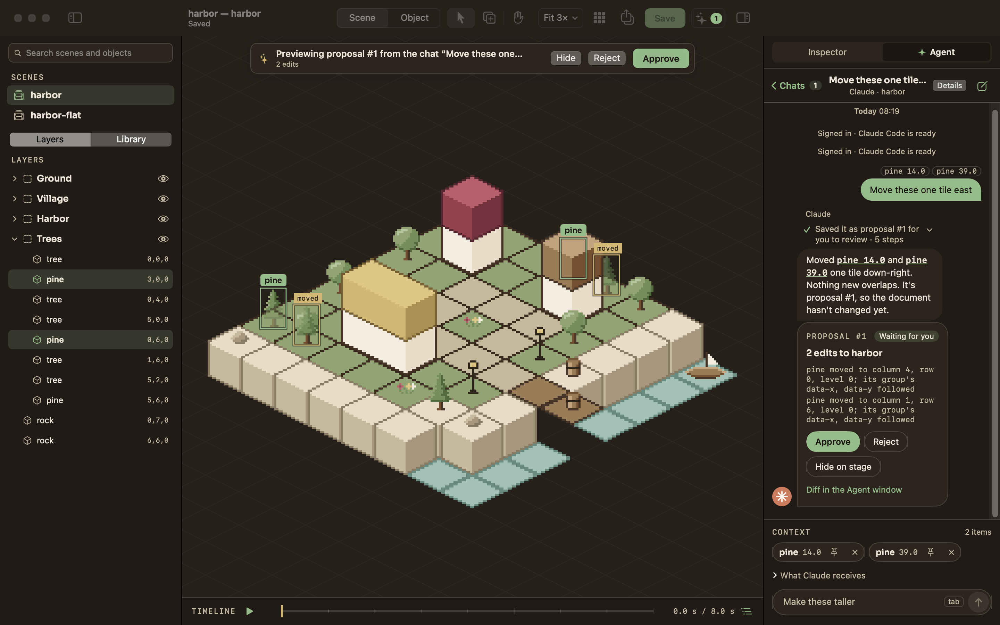
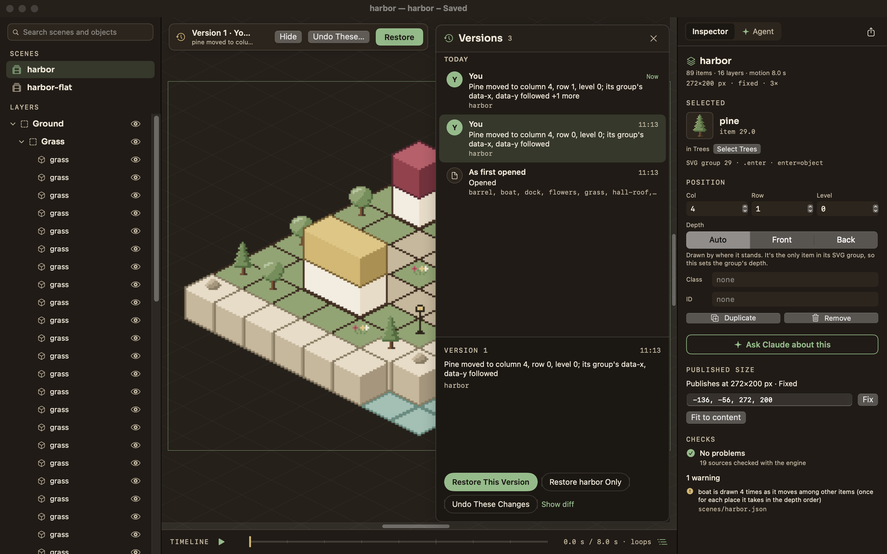
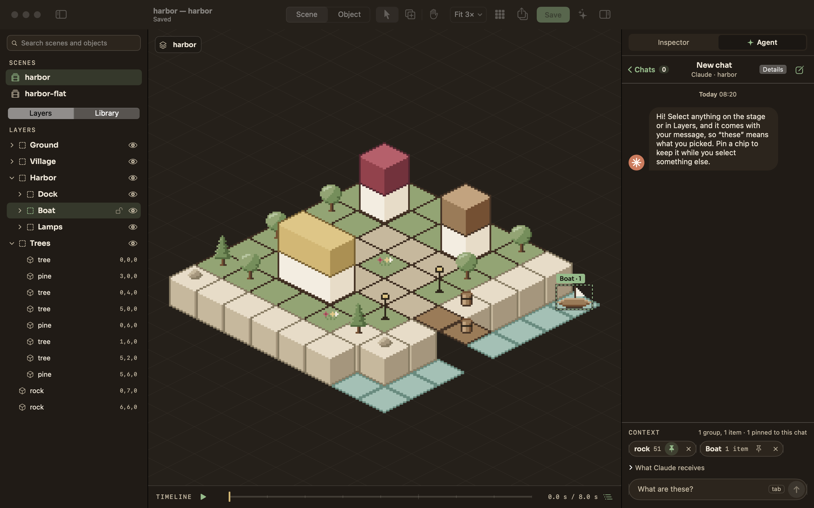

# Pixel Lab for Mac

A native macOS editor for isometric pixel art: the hero island of [jlawcordova.github.io](https://github.com/jlawcordova/jlawcordova.github.io) and its other scenes, and the library objects they're built from. The art lives in a **`.pixellab` document**, a folder you can open, copy and save as like any file; **Publish** compiles it into the SVGs a site inlines.

It's built CLI first: every action is a command in one registry, reachable three ways, so an agent can do everything a person can.

- **Pixel Lab.app**: a SwiftUI app (board 03, "Field notebook", night and day).
- **`pixellab`**: one native program, written in Rust (`pixellab scene place hero-island pine --at 14,6,1`), which is also the pixel-art engine and compiler. It needs nothing installed to run, and it's bundled inside the app.
- **`pixellab serve --mcp`**: an MCP server for Claude Code and other agents. Agents' edits apply as they make them, you see them on the stage, and every change is in the document's **version history**, so any of them can be taken back.
- **The Agent chat**: Claude, in a tab beside the inspector, running on your own Claude Code install and plan, with what you select on the stage going along with your message.

The document is the source of truth: the engine in this repo validates and serializes every write into the document's JSON sources (format 2), and nothing touches a site until you publish. The compiled SVGs are self-contained: they carry their own styles and animations, so a site only inlines them. The site keeps its document next to the SVGs it compiles to, and builds them with the released `pixellab` program.


## Requirements

- macOS 15 or later, Apple silicon or Intel.
- A `.pixellab` document. With none chosen, Pixel Lab opens the one in `~/Projects/jlawcordova.github.io` when that checkout is there (or its older `source/` folder); File › New Document… makes one anywhere.
- To build: the Xcode Command Line Tools (Swift 6) and [rustup](https://rustup.rs), which installs the Rust toolchain `rust-toolchain.toml` pins on first use. Full Xcode isn't needed, and neither is Node.
- For the Agent chat (optional): [Claude Code](https://claude.com/claude-code), signed in with your Claude plan. The Agent tab can install it and sign you in.

## Install

### From a release

Each [release](https://github.com/jlawcordova/jlawcordova-lab/releases) has Pixel Lab.app for Apple silicon as a disk image (`PixelLab-darwin-arm64.dmg`) and a zip of the same app (`PixelLab-darwin-arm64.zip`), the program alone for a terminal or a site's CI (`pixellab-darwin-arm64.tar.gz` and `pixellab-linux-x64.tar.gz`, each holding the one executable), and `SHA256SUMS` for all four. Download them from the release page, or with `gh`:

```sh
gh release download --repo jlawcordova/jlawcordova-lab --pattern 'PixelLab-darwin-arm64.dmg' --dir /tmp
```

Open the disk image and drag Pixel Lab to `~/Applications` (create the folder if needed). The app carries the program, so there's nothing else to install. Then connect Claude Code with the `claude mcp add` command below. The app is ad-hoc signed and the download is quarantined, so the first launch is blocked: allow it under System Settings › Privacy & Security › Open Anyway. To update, quit Pixel Lab and replace the app with the newer one.

To check a download, run `grep ' <file>$' SHA256SUMS | shasum -a 256 -c` in the folder holding both. To use the program without the app, unpack `pixellab-darwin-arm64.tar.gz` (or the Linux one) and put the `pixellab` inside on your PATH; `pixellab --version` prints the release. On an Intel Mac, install from source.

### From source

```sh
git clone git@github.com:jlawcordova/jlawcordova-lab.git ~/Projects/jlawcordova-lab
cd ~/Projects/jlawcordova-lab
scripts/install.sh
```

`scripts/install.sh` builds the program with cargo and the app with Swift into `build/Pixel Lab.app` (release build, ad-hoc signed) and copies it to `~/Applications` (it creates the folder if needed; no sudo, never `/Applications`). It ends by printing the `claude mcp add` command and an optional shell alias, both pointing at the program inside the installed app:

```sh
claude mcp add pixellab -- "$HOME/Applications/Pixel Lab.app/Contents/Helpers/pixellab" serve --mcp
alias pixellab='"$HOME/Applications/Pixel Lab.app/Contents/Helpers/pixellab"'   # in ~/.zshrc
```

Options: `--no-build` installs the existing build, `--dest <dir>` installs somewhere else. Run it again to update; quit Pixel Lab first.

The app is signed ad hoc, not notarized. If macOS won't open it the first time, Control-click it in Finder and choose Open, or allow it in System Settings › Privacy & Security.

## First launch

Pixel Lab opens the document in `~/Projects/jlawcordova.github.io` if that checkout is there, and starts its own `pixellab serve --stdio` server on it. If the document can't be found, a setup screen says what's missing, with Choose… for a `.pixellab` (or a site checkout holding one), New… to make one, and Try Again. If the document is still in the old format (`.mjs` sources, format 1), the screen says so and offers **Migrate…**: it converts the document in place to JSON sources after you confirm, checks first that every scene compiles to the same SVG, and can be undone with git. Change the document later in **Settings** (⌘,), along with the appearance (Auto, Light, Dark). Double-clicking a `.pixellab` in Finder opens it too.

It reopens the last scene or object you had open, else the hero island. The window title shows the open doc and the document's name.


## A short tour

**The window.** The canvas is the window. There is no toolbar: the left sidebar lists every scene and, under it, the open scene's **Layers** (or, in an object, its **Palette**); the right panel is always shown. A **floating bar** at the bottom center of the stage holds the tools: **Select** (V) and **Hand** (H), and the **Library** (L) in a scene; the paint tools and the Hand in an object. Zoom with a trackpad **pinch** (or ⌘-scroll, or View › Zoom In ⌘= and Zoom Out ⌘−; ⌘0 fits): a pinch zooms as your fingers do, smoothly between 1× and 4× in a scene (4×–16× in an object), and keeps the art under the pointer where it is; ⌘= and ⌘− and ⌘1–⌘4 go to whole levels, where the pixels are even,. There's no zoom readout. Scroll with two fingers, drag with the Hand or hold Space; the scroll bars follow the system's "Show scroll bars" setting. **Publish** is in the right panel's tab row, beside **Inspector** and **✦ Agent**; there's no Save button, since edits save themselves.

**Scene mode.** The stage draws the scene crisply on the 32×16 isometric grid; in the night appearance the hero island's drop shadow takes the page color, as the site's dark theme does. Open the **Library** (the bar's button, or L): a search field and a grid of small thumbnails, which scrolls if the library is large. Click an object to start placing it, then click a tile (⌥-click places by pixel; Esc or V stops); or drag a thumbnail onto the stage to place one where it lands. A thumbnail's right-click menu has Place and **Edit Object**, and so does double-clicking it. Click an item to select it; drag it, use the arrow keys, or edit Col, Row and Level (X, Y and Level for pixel-placed items) in the inspector. Duplicate, Remove and Snap to Tile are in the inspector and the Edit menu. Everything undoes. Scenes with motion get a timeline: Play (⌥⌘P) and scrub.

**Size.** A scene made with `scene new` has no size: it has no `viewBox`, the canvas works as if it were infinite, and nothing is cut off. The size is decided when the scene is published, at the smallest whole-pixel box that holds everything the scene paints over its whole loop (its motion, ambient loops and actions included) plus its `margin` (default 0). A scene that has a `viewBox` keeps it and publishes exactly as before. `pixellab scene frame <name>` reports a scene's frame, `--box x,y,w,h` fixes the size on purpose, `--fit` takes it off again and `--margin n` sets the margin; `scene show` and `scene list` print "fits 272×200" or "fixed 272×200", `scene render` returns the resolved `viewBox` and `frame` (and takes `--view x,y,w,h` to render a window of a big scene), and `pixellab check` warns when a fixed `viewBox` cuts off painted pixels. In the app the stage has no edge: place, select and scroll anywhere, and an outline in the accent shows the box the scene would publish at (View › Show Published Frame), with its size and Fits the content or Fixed in the inspector, where Fit to content takes a fixed size off. [docs/document-format.md](docs/document-format.md) has the rules.

**Stacking.** `scene place` with no level (`--at col,row`, or no position at all) puts the item on top of the highest block on that tile, in whole levels, or on the ground (level 0); a block rests its bottom on the top of the block under it. A level given (`--at col,row,level`) is used as given, and `--on-top` stacks whatever the position says. `scene drop <name> <item>` drops an item onto whatever it stands over, down to the top of the block under it or the ground, never up. Both are one undo step, and both are MCP tools (`scene_place` with `onTop`, `scene_drop`, `scene_frame`).

**Depth.** Items draw back to front by where they stand, and you never order them by hand: every edit (placing, moving, setting a field, snapping, duplicating, removing, undo, an agent's edit, a merge) leaves the scene's items in depth order, and the engine draws them in that order whatever the file says, so what's published is right even for a file edited by hand. An item's place in the order comes from a box in tile space: a block's `size`, a sprite's footprint and height, a pixel-placed item's Level. The inspector's **Depth** control (Auto, Front, Back) is the one manual override: Front draws the item over everything else in its list, Back under everything. An item that is its SVG group's only item (as every item on the site's island is) sets the group's depth instead, because the group is what sorts in the scene; in a group of several items it orders the item among them, and the group's own depth is set from its wrapper line in the inspector. **Level** says how high a pixel-placed item stands, which only matters for depth (its X and Y are still where its foot is drawn). **Footprint**, two steppers in an object's inspector (sprites only), says how many tiles a large sprite covers, so a house or the crane mast sorts against its neighbours by the ground under it. An item with motion takes its place among the others as it moves, so the published SVG draws it once for each place it takes, and the inspector's CHECKS section (and `pixellab check`) lists those copies. A scene whose file isn't in depth order (hand-edited, or made before this change) shows a warning in the CHECKS section with a **Sort** button, or run `pixellab scene sort --all` (add `--dry-run` to see what would move and how many published pixels change).

**Layers.** Name the parts of a scene, and nest them: the Mine, the Railway, the Train inside it. The **Layers** tab shows them as a tree (each layer's layers, then its items); a scene without layers lists its items at the top level. Select things (⇧-click adds) and Group them (⌘G, or right-click › Group): the new layer, "Group 1", goes under their common parent and is renamed in the inspector. Ungroup (⇧⌘G) moves a layer's contents up a level, where they stay. On the stage a click picks the outermost layer under the pointer (by its pixels, not its box); double-click a layer, or Go Inside, to work inside it: the rest fades, the pill at the top left says where you are (`hero-island › Railway › Train`), clicks pick the next level down, and Done or Esc leaves. Dragging moves everything selected by whole tiles, with the col/row change on its label; the arrow keys and the inspector's nudges do too, and its Moved by fields say how far the layer has gone since you selected it. The eye hides a layer or a single item and the lock stops clicks on the stage from picking it (except from inside a locked layer); a hidden item isn't drawn, and a locked one is passed by on the stage but still selects from the tree, the inspector and the keys; they're kept for each document and scene but never saved in the document or published. Right-click the stage or a row for Group, Ungroup, Go Inside, Hide and Lock. What you place goes into the selected layer, the selected item's layer or the one you're inside (the placing preview's tag says which, "pine → Trees"), else the top level, and Place into it in a layer's inspector starts placing there. Layers never change draw order or the published SVG: each item still draws back to front by where it stands (see Depth above), and the site's `{ group }` wrappers stay as they are (an item's shows in the inspector as its SVG group).


**Object mode.** Open an object: **Edit Object** from the Library's menu, from the stage's right-click menu on an item, or Edit › Edit Object (⌘↩) on the selected item; or find it by name in the sidebar's search. A pill at the stage's top left, **‹ Back · hero-island › house**, returns to the scene you came from (View › Back, ⌘[). Paint with the Pencil, Eraser, Fill and Picker from the palette (the color cap is shown and enforced), switch layers and frames, turn a layer into a frame loop, toggle the onion skin, and watch the preview at 1× and 2× on a tile. File › New Scene… and New Object… make new docs from the engine's starters.

**Saving.** There's nothing to remember: every edit, yours or an agent's, saves itself about a second after the last one, and at once when the window loses focus, when you close or quit, before Publish, Save As or a chat message. The title bar says **Saved**, **Edited** (a save is coming) or why it can't save. A doc with problems is never written: the title says "Not saved: 2 problems", a gold row at the top of the Inspector offers Check, and it saves itself once they're fixed; closing or quitting is the only time it asks (Review, Save Anyway, Discard Changes). Undo works across saves. File › Save (⌘S) still saves at once, and starts a new version.

**Versions.** Every change is kept in the document's version history (in Pixel Lab's own folder, never in the document, so the site and git don't see it). A version is a stretch of one author's work: yours, an agent's (named, with the chat it came from), the CLI's, or a change from outside Pixel Lab. File › Revert To › **Browse All Versions…** opens the Versions panel beside the stage: versions newest first by day, the selected one ghosted on the stage (what differs outlined in gold), its edits and diff, and three ways back: **Restore This Version** (the whole document), **Restore <doc> Only**, and **Undo These Changes** (just that version's changes, keeping everything since; it says so when later edits touched the same lines). Each is one ⌘Z and a version of its own. Revert To › **Last Opened** puts the document back as it was when you opened it. Old versions thin to one a day after a day, and one a week after a month.

**Checks.** The inspector's CHECKS section validates the open doc with the engine after every edit; a problem that names an item selects it when clicked.

**Changed on disk.** A doc you have open reloads when its file changes (git, another editor, the CLI from another folder). If a save of yours was pending, the change is merged into it, three ways, and saved, without asking. Only when you both changed the same lines does a bar come up over the stage: **Reload** loads the file and drops your edits (Undo brings them back), **Keep Mine** saves your copy over it.

**One writer.** While Pixel Lab has a document open, it's the one thing that writes it: the CLI and agents send their commands to the app, so their edits land in your open copy, show on the stage at once and save with yours. With the app closed, they write the files themselves. Opening a document that another Pixel Lab window has open brings that window forward instead.

**Publish.** ⌘B or the share button in the right panel compiles every scene that has an `output` into the SVGs a site inlines (merging each color's pixels into one path, checking the result is lossless and within its budget) and writes them into the document's publish folder, the one its `manifest.json` names (the site's document publishes next to itself, so `astro dev` picks the change up at once). It saves everything first, and the sheet shows each output's size, problems or over-budget files. File › Publish to Folder… (or Publish Elsewhere… in the sheet) writes anywhere else; a document whose manifest names no folder asks for one.

**Documents.** File › New Document… makes an empty `.pixellab` with the starter palette; Open Document… (⌘O) opens another; Save As… (⇧⌘S) copies the whole document (palette, objects, scenes, manifest) to a new place and reopens it there. A document is a plain folder, so git, Finder and backups see it as one.


**The Agent chat.** The right column has two tabs, **Inspector** and **✦ Agent**; Window › Agent (⌥⌘A) and the Inspector's **Ask Claude about this** open the Agent tab. It runs the Claude Code installed on your Mac, signed in the way it already is, so it uses your Claude plan (Pixel Lab adds no API key and bundles none of Claude Code). Claude can only use Pixel Lab's tools on the open document: no shell, no file edits, none of your own Claude Code settings, hooks or other MCP servers.

- **Setup.** The first time, the tab finds `claude` in `~/.local/bin`, Homebrew or your shell's PATH. If it isn't there, **Install Claude Code** runs Anthropic's installer (`curl -fsSL https://claude.ai/install.sh | bash`, shown before it runs; or copy it for Terminal, or choose the `claude` command yourself). **Sign in with browser** runs Claude Code's own sign-in (`claude auth login`) and waits until `claude auth status` says you're in. Sign out (the Chats list, the Agent window) signs Claude Code out on this Mac, Terminal included.
- **Context.** What you select comes with your message: a click on the stage picks a layer first, a double-click goes inside it, ⇧-click adds, and ⌥-click selects every use of the object under the pointer (Edit › Select Every Use does it for the selected item). Each layer or item shows as a chip above the input, a layer with its item count; ✕ removes it and the pin keeps it in this chat while you select something else. **What Claude receives** shows the `<selection>` block sent with the message: the document, the scene and the saved file's version, each group with its items, each item with its object, position and group. Sending saves first, so Claude sees what you see; only a doc with problems can't be, and its chips turn dashed gold.
- **Asking.** The placeholder suggests something that fits the selection ("Raise them a level", "Make these taller", "What are these?"); Tab takes it while the input is empty. Return sends, ⇧Return adds a line, Stop (or Esc) ends a turn. Claude's tool calls read as sentences ("Moved pine 14.0 one tile down-right"), folded into one line you can open; **Details** shows the raw call under each. Item and group names in its replies are links that select them. When it needs you to choose, it asks with buttons.
- **Changes.** What Claude changes applies as it works: you see it on the stage. A turn that changed something ends with a card, CHANGED, its edits and docs, **Undo These Changes** (the whole turn, one step) and **Show in Versions**.
- **Chats.** ‹ Chats lists them, newest first, with their last message, pins and changes; each keeps its own Claude conversation, pins and history in the state folder (`chats/`), across launches, per document. New chat starts another; a chat is titled by its first message.







**Agent window.** Window › Agent Window (⇧⌥⌘A), or the links in the Agent tab. It shows Claude Code's status (version, signed in, how many chats, Open chats, Sign out), the `claude mcp add` command to connect an agent from a terminal, the live activity feed of every MCP tool call ("listed 15 scenes", "rendered hero-island at 2×", "pine placed at x -48, y 92"), filtered by All, Chats or Errors. What agents changed is in the Versions panel, by author.


## Keyboard shortcuts

| Keys | Does |
| --- | --- |
| V / H | Select / Hand tool (scene mode); V also stops placing |
| L | Open or close the Library (scene mode) |
| B / E / G / I / H | Pencil / Eraser / Fill / Picker / Hand (object mode) |
| Space (hold) | Pan with any tool |
| Pinch, ⌘-scroll | Zoom smoothly, under the pointer |
| ⌘= / ⌘− | Zoom in / out to the next whole level, centered on the stage |
| 1 – 4, 0 (or ⌘1 – ⌘4, ⌘0) | Zoom 1×–4× (objects 4×–16×), Fit |
| ⌘' | Show or hide the grid (the pixel grid in object mode) |
| View › Show Published Frame | Show or hide the outline of the box the scene publishes at (scene; no key) |
| Arrows | Move the selection a tile, layers too (scene), or the pixel cursor (object; ⇧ moves 4) |
| ⌥ + arrows | Nudge one selected item a pixel |
| ⇧↑ / ⇧↓, Page Up / Page Down | Selection up or down a level (scene); previous or next frame (object) |
| Tab / ⇧Tab | Select the next / previous item in depth order, inside the layer you're in (scene, on the stage) |
| ⌘↓ | Drop the selection onto what it stands over: the top of the block under it, or the ground (scene; Edit › Move) |
| Return | Place at the stage cursor, on top of a block that is there unless you set the level (scene); paint at the pixel cursor (object) |
| ⌫ | Remove the selection (scene); erase at the pixel cursor (object) |
| Esc | Select none; then leave the layer you're inside; then stop placing; then close the Library |
| ⌘↩ | Edit Object: open the selected item's object |
| ⌘[ | Back from an object to its scene |
| ⌘G / ⇧⌘G | Group the selection into a new layer / ungroup the selected layer |
| Double-click (stage or Layers) | Go inside a layer |
| ⇧-click | Add to (or take from) the selection |
| ↑ ↓, ⇧↑ ⇧↓, → ←, Return, Esc | Layers (focused): select the previous / next row, add it, expand / collapse, go inside, clear the selection and then leave |
| ] / [ | Next / previous layer (object mode only) |
| . / , | Next / previous frame (object) |
| ⌘D | Duplicate |
| ⌘Z / ⇧⌘Z | Undo / Redo |
| ⌘S / ⇧⌘S | Save now and start a new version / Save As… (a copy of the whole document) |
| ⌘B | Publish |
| ⌥⌘P | Play / pause the timeline |
| ⌘N / ⇧⌘N | New Scene / New Object |
| ⌥⌘N / ⌘O | New Document… / Open Document… |
| ⌥⌘A | The Agent tab (the chat) |
| ⇧⌥⌘A | The Agent window (activity) |
| ⌥-click (stage) | Select every use of the object under the pointer (⇧⌥ adds them) |
| Tab, Return, ⇧Return, Esc | Agent tab input: take the suggestion (while empty), send, add a line, stop |
| ↑ / ↓, Return, ⌘⌫, Esc | Versions panel: newer / older version, Restore (asks first), Undo These Changes, close |

## The CLI

`pixellab <group> <verb> [args] [--json] [--document <path.pixellab>]`. Human output by default, JSON with `--json`; `pixellab help` and `pixellab <group> --help` list everything. The full reference is [docs/cli.md](docs/cli.md).

```sh
pixellab document info                               # the document in use, its publish folder, counts, problems
pixellab document new ~/Art/meadow.pixellab          # an empty document with the starter palette
pixellab scene list
pixellab scene render hero-island --scale 2 --out /tmp/hero.png
pixellab scene place hero-island pine --at 14,6,1 --dry-run   # the diff it would write
pixellab scene place hero-island crate --at 14,6               # no level: on top of the block there
pixellab scene drop hero-island 12                             # rest an item on the block under it
pixellab scene frame hero-island --box -16,-16,272,200         # fix the published size (--fit takes it off)
pixellab scene layer new hero-island --layer-name Railway --items 140.0,141.0   # a layer from items
pixellab scene layer move hero-island railway --by 1,0      # every item in it, by a tile
pixellab object paint house 20,30 21,30 --color water-1
pixellab check hero-island
pixellab art preview pine --scale 4 --out /tmp/pine.png       # the review PNG, on the card color
pixellab art build                                   # publish: compile every scene and write the SVGs
pixellab art sizes hero-island                       # bytes per object and color, against git HEAD
pixellab history list                                # the versions, newest first, by author
pixellab history undo 12                             # take back just what version 12 changed
```

The document comes from `--document`, else `PIXELLAB_DOC`, else `~/.config/pixellab/config.json` (`{"document": "…"}`), else `--site <checkout>` / `PIXELLAB_SITE` (the `*.pixellab` under the site's `src/assets/pixel-art/`, or its older `source/` folder), else the default site checkout. Edits from the command line are one-shot: load, edit, validate, serialize with the engine, write atomically, and record a version by the CLI. They refuse docs with problems or files changed on disk unless `--force`. While Pixel Lab has the document open, a command runs in the app instead (it says "saved by Pixel Lab"), so the edit shows on the stage. Inside the repo use `target/release/pixellab` (after `cargo build --release`), or the alias from Install.

**The document.** A `.pixellab` is a folder: `manifest.json`, `palette.json`, `objects/*.json` and `scenes/*.json`, the sources exactly as the engine reads them (format 2). The manifest holds `"format": 2`, a name, and what publishing needs: `publish.dir` (relative to the document) and per-output `budgets`, plus the `preview` colors and the night `theme` color. Everything but `format` is optional. [docs/document-format.md](docs/document-format.md) has every field. A format-1 document (`.mjs` sources) is migrated, not edited: `pixellab document migrate` converts it in place (or `--to <path>.pixellab` writes a copy), after checking that every scene still compiles to the same SVG, and the app offers **Migrate…** on its setup screen.

**As a program.** A site that inlines the art downloads the release's `pixellab` for its platform, checks it against `SHA256SUMS`, and runs `pixellab art build` (the same program on a Mac or in Linux CI; no Node and no package to install). The compiled SVGs carry `data-pixellab`, scope their generated names to the scene, and play frame loops, motion, ambient loops and actions from their own `<style>`: an action plays when the page sets `data-play` and ends with `animationend`. A scene over its budget is written with a warning, not refused. What a site may rely on is in [docs/site-contract.md](docs/site-contract.md).

## MCP for Claude Code

```sh
claude mcp add pixellab -- "$HOME/Applications/Pixel Lab.app/Contents/Helpers/pixellab" serve --mcp
```

(Without the app, point it at the `pixellab` you unpacked from a release instead. The Agent window's Copy button gives the command for the running app. Add `--document <path.pixellab>` or `--site <checkout>` after `--mcp` for another document.)

Tools are the commands with `.` → `_` (`scene_place`, `object_paint`, `scene_render` returns the PNG so the agent can see it, …). Agents never order items: `scene_place` and every other scene edit leave the scene in depth order, `scene_set` takes `depth` (front, back or auto) and a pixel item's `level`, `scene_sort` fixes a scene, and `object_footprint` sets a sprite's footprint. Besides placing and painting, agents can place into groups and edit a group's attributes (`scene_group_set`), key motion (`scene_track_add`, `scene_key_set` for move, show and pose keys, `scene_motion_path` for on-grid keys along a polyline), and set a whole map in one call (`object_map_set`). **How agents' edits work:**

1. An edit applies as the agent makes it. While Pixel Lab has the document open, the agent's MCP server sends it to the app: you see it on the stage, the Edit menu names it ("Undo Pine Placed… (Claude)"), and it saves with yours. With the app closed, the agent's server saves each edit itself.
2. Every change is a version by the agent, with the chat it came from: `history_list`, `history_show` and `history_render` let it look back, and `history_undo` takes back a whole version of its own. `doc_undo` takes back its latest step, and refuses when you've edited since.
3. A doc with problems isn't saved until they're fixed; `check` says what they are.
4. Publishing is yours: agents can't publish or save a copy (Publish, ⌘B, compiles the document into the SVGs). `--direct` from earlier setups is accepted and ignored.

Every tool call is logged to `activity.jsonl` in the same folder and shown in the Agent window. `PIXELLAB_STATE` moves the state folder.

## The Agent chat and Claude Code

**Your Claude plan and its terms.** The Agent chat is for your own use of your own Claude Code install: Pixel Lab starts `claude` the way a terminal would, signed in with your account, and every message counts toward your plan's limits. If Pixel Lab is ever shipped to others, each person needs their own Claude Code install and login, and Anthropic's current terms (the Consumer Terms, the Usage Policy, and its guidance on using Claude subscriptions in other products) should be checked again first.

**Verify the chat with your real Claude Code.** The tests use a stand-in (`scripts/fake-claude/`), so after installing, open the Agent tab once with your own Claude Code: sign in if it asks, select two items and send "What are these?". A reply with the item names as links, and its steps above it, means the real CLI's stream reads the way the app expects.

## Troubleshooting

- **"… uses the old format."** The document is still format 1 (`.mjs` sources). Choose Migrate… on the setup screen, or run `pixellab document migrate` on it (or with `--to` for a copy). It refuses while Pixel Lab has the document open, and an `.mjs` source that isn't plain data is named with its file, line and column.
- **Document not found.** The setup screen names the path it tried and what's wrong (no folder there, or no `palette.json` in it). Choose a `.pixellab`, a site checkout holding one, or make a new one. The CLI resolves the document from `--document`, `PIXELLAB_DOC`, `~/.config/pixellab/config.json` (`{"document": "…"}`), then `--site` / `PIXELLAB_SITE` / `{"site": "…"}`, then `~/Projects/jlawcordova.github.io`.
- **Publish fails or is refused.** Nothing is written when a source has a problem: the sheet lists them (so does the Checks panel), fix them and publish again. An output over its budget is written and flagged; make the art smaller or raise its budget in `manifest.json`. A document whose manifest names no publish folder asks for one.
- **"Not saved: changed on disk."** Someone (git, another editor) changed the same lines of the source as a save of yours that was pending. Reload loads the file (Undo brings your edits back); Keep Mine saves your copy over it.
- **"Not saved: n problems."** Autosave doesn't write a doc with problems. Check lists them; the doc saves itself once they're fixed. Version history has the doc as it last saved.
- **An agent changed something you didn't want.** File › Revert To › Browse All Versions…, select the agent's version and Undo These Changes (or the chat card's button). `pixellab history undo <n>` does the same from a terminal.
- **"Another Pixel Lab window has this document open."** Two copies of the app can't own one document; the one that has it comes forward. `pixellab` commands go through that copy too.
- **The Agent tab says Claude Code isn't installed, or keeps asking to sign in.** It looks in `~/.local/bin`, `/opt/homebrew/bin`, `/usr/local/bin` and your login shell's PATH; choose the command if it's elsewhere. Check `claude auth status` in Terminal: the chat uses the same login. If the browser sign-in doesn't finish (Claude Code asks for a code in the terminal), run `claude auth login` in Terminal and press Check again. A turn that stops with "Pixel Lab's tools didn't start" means the bundled program couldn't run: check that `Pixel Lab.app/Contents/Helpers/pixellab --version` runs, and reinstall the app if it doesn't.
- **The app won't open the first time.** It's ad-hoc signed; Control-click › Open, or allow it in System Settings › Privacy & Security (Open Anyway, which a downloaded release always needs).

## Development

The developer docs are in [docs/README.md](docs/README.md): the architecture, contributing, testing, and a README for each of [`crates/pixellab/`](crates/pixellab/README.md), [`app/`](app/README.md) and [`scripts/`](scripts/README.md). They're also published as a site at [jlawcordova.com/jlawcordova-lab](https://jlawcordova.com/jlawcordova-lab/), built with `npm run docs:site` and deployed from `main` by [`.github/workflows/docs.yml`](.github/workflows/docs.yml).

```sh
cargo test                                 # the Rust suites (engine and program)
npm test                                   # builds the program, then the repo tooling's tests (node:test), must show "# fail 0"
scripts/test-app.sh                        # app unit tests (Swift Testing, works with the Command Line Tools)
swift build --package-path app             # debug build; swift build -c release for release
scripts/build-app.sh                       # build/Pixel Lab.app (icon, bundled program, ad-hoc signature)
scripts/snapshot.sh /tmp/hero.png scene:hero-island dark   # read-only self-snapshot of the main window
scripts/acceptance.sh                      # the end-to-end acceptance pass on a temp copy of the site
scripts/try-example.sh town                # the app on a temp copy of an example document (examples/)
npm run examples                           # rewrite examples/ from scripts/make-examples.mjs
cargo build --release                      # target/release/pixellab, the program (the pinned toolchain installs itself)
npm run docs:cli                           # regenerate docs/cli.md from the program's command registry
npm run docs:site                          # build the developer docs site into build/docs-site/
```

**Example documents.** [`examples/`](examples/README.md) has two documents to try scene layers on without the site: `harbor.pixellab`, a small island with layers three deep and the site's `{ group }` wrappers, and `town.pixellab`, about 400 items in 59 layers four deep. `scripts/try-example.sh [harbor|town]` opens the built app on a temp copy, so nothing in the repo changes.

**Script hook.** `PIXELLAB_SCRIPT=<file> PIXELLAB_DOC=<temp copy of a document> PIXELLAB_STATE=<temp dir> "build/Pixel Lab.app/Contents/MacOS/PixelLab"` (or `PIXELLAB_SITE=<temp copy of the site>`) drives the app's model headlessly, one action per line (`open scene:hero-island`, `library pine`, `place 4 -1 1`, `move 1 0`, `save`, `publish`, `saveas <path>`, `mode object`, `px 23 20`, `agent open`, `approve`, `snapshot <png>`, `expect …`); it refuses the real checkout and anything inside it, logs each step and exits 0 only if every step passed. The action list is at the top of `app/Sources/PixelLab/Support/ScriptRunner.swift`; [CLAUDE.md](CLAUDE.md) says how to make the temp copy.

**Releases.** Tags `v<major>.<minor>.<patch>` publish a GitHub Release ([`.github/workflows/release.yml`](.github/workflows/release.yml)). **The tag is the version:** nothing in the repo is bumped. The workflow passes it to `scripts/build-app.sh` and `scripts/package-program.sh` (`PIXELLAB_VERSION`), which build it into the program (`pixellab --version`, and the version the MCP server reports) and stamp it into the app's `Info.plist`. The repo's `package.json` and `Cargo.toml` say `0.0.0-dev`; a local build or `scripts/install.sh` takes its version from `git describe` (`0.4.0-3-gabc1234` after three commits past `v0.4.0`).

1. With what you want released merged to `main`, run `scripts/build-app.sh` and `scripts/acceptance.sh` on it (CI doesn't run the acceptance pass: it pins today's art).
2. Tag `main` and push the tag:

   ```sh
   git fetch origin && git tag -a v<version> -m "Pixel Lab <version>" origin/main && git push origin v<version>
   ```

The **Release Pixel Lab** workflow checks that the tag looks like `v0.4.0` and that the commit is on `main`, then builds and tests the program for Linux, and tests the program, the repo's tooling and the app on a Mac. It builds the app on Apple silicon with the tag's version, packages the app (`PixelLab-darwin-arm64.dmg` and `.zip`) and both programs (`pixellab-darwin-arm64.tar.gz` and `pixellab-linux-x64.tar.gz`, each built by `scripts/package-program.sh <target> <dir>`, which also writes the `SHA256SUMS` line), installs the app from the disk image and smoke-tests it (signature, the bundled program's MCP server reporting the tag's version, the app opening a scene of the fixture through the script hook), then publishes the release with the five files and generated notes. If it fails, delete the tag (`git push origin :refs/tags/v<version>`), fix it, and tag again.

Layout: `crates/` (the Rust engine, `crates/engine`, and the program, `crates/pixellab`; the toolchain is pinned in `rust-toolchain.toml`), `app/` (SwiftPM, SwiftUI + AppKit, macOS 15+), `scripts/`, `docs/intents/` (each change's intent, spec and plan; `2026-10-mac-app/plan.md` is the architecture and design record), `docs/cli.md` (the command reference), `docs/*.md` and each folder's `README.md` (the developer docs). Node is only repo tooling (the docs site builder, the example and icon generators, the fake `claude`, `scripts/test/`); the program, the app and agents never need it. Dependencies: `serde`, `serde_json` and `miniz_oxide` for the program, none for the app.
