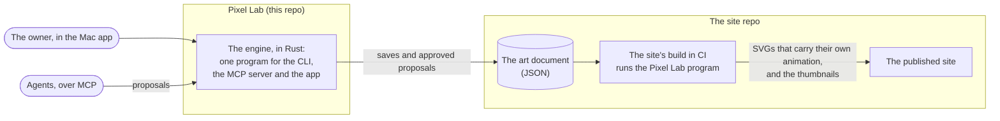

# Intent: The engine in Rust, and a site that only takes its output
Author: J. Law Cordova (owner) · 2026-10-21 · Status: accepted.

## Problem

In the owner's words:

> Would it be possible to rewrite the Pixel Lab CLI MCP server and engine in Rust instead of using node?

> Is the engine even needed in the site? Like, I want the engine to live inside only in Rust, and whatever output we do, that's what's being used in the site. And the output could be something like an SVG or a bundled component, but we don't have a separate engine for the site.

Today the engine lives in two places at once. Pixel Lab runs it, and the site installs it as a library: its build scripts render the blog thumbnails with it, its tests import its internals, and its agents and skills edit the art as JavaScript modules. So a change to the engine is also a change to what the site's code depends on. The art isn't self-contained either. The scenes' own motion plays from inside each SVG, but the water and fire frame loops, the clouds, the floating and the bobbing only move because a stylesheet in the site, kept in step with the engine by hand, plays them.

Pixel Lab also needs Node. The app asks for it on its setup screen, and nothing works until the owner has installed it.

## Proposed outcome

- **One engine, in Rust.** The engine, the compiler, the CLI and the MCP server are rewritten in Rust as a single program. It is the only engine: the app, the CLI, agents and the site's build all run the same one.
- **The document is data.** The art document's sources move from JavaScript modules to JSON, which the Rust engine reads and writes. The owner's existing document, and the examples, are migrated to it.
- **The site keeps its art, not the engine.** The document stays in the site repo, where the art is edited. The site drops the library entirely: no engine code and no imports of it. The site's build in CI runs the Pixel Lab program to produce the SVGs and thumbnails, so the outputs don't need to be committed to the site repo.
- **Self-contained art.** Every SVG carries its own animation: the scene's motion, the frame loops, the ambient loops, and its own reduced-motion behavior. The site no longer needs a stylesheet that knows how the art animates.
- **Animation that answers the visitor comes with the art too.** The Range character's hop is carried by the art. The site asks the art to play it by name, when someone presses the button, and hears back when it ends. The site no longer knows how the hop moves.
- **Over budget is a warning, never a failure.** A scene over its size budget is still built, everywhere (the app, the CLI and the site's build), and a warning says so.
- **The site's art tests leave the site.** The ones that test the engine come to Pixel Lab. The ones that pin the site's particular art are dropped, so this repo doesn't depend on the site's art.
- **Two builds of the program.** One for the owner's Mac and one for the site's CI.
- **Nothing to install first.** Starting the app needs no Node, and no Rust set up by hand. The app's setup screen no longer asks for Node.

## Affected users and systems

- **The owner in the app:** the setup screen and Settings, which ask for Node today. Editing, saving, publishing and the Agent window should work as they do now.
- **Agents over the CLI and MCP:** the same commands and proposals, now from the Rust program.
- **The art document:** its format changes, for the owner's document in the site repo and for the examples here.
- **The site repo (`jlawcordova.github.io`):** its dependency on the library, its build in CI, its thumbnails script, its art tests, the stylesheet that animates the art, and the agents and skills that edit the art. That work is a change in the site repo, with its own intent, which depends on this one.
- **Install and release:** what the app bundles, and the builds a release publishes.

## Constraints

- **The migration must be safe.** The published art must look and move the same as it does today, through every step of the change.
- **Pending MCP proposals are dropped.** Proposals made before the change are no longer valid. The change starts from a clean slate and doesn't need to carry them over.
- **New dependencies only with the owner's approval,** Rust crates included, as with npm and Swift today.
- **Edits stay proposals.** What agents change still becomes a proposal the owner approves in the Agent window.
- **VoiceOver labels, visible focus and Reduce Motion** stay on everything the app shows, including the changed setup screen.
- **Out of scope:** new features in the app or the engine beyond what self-contained animation needs, and changes to the art itself.
- **Amended 2026-10-21, after the intent was accepted:** the owner decided the hop, the budgets, the art tests and the open questions below while the spec was being prepared. The spec answers the questions.

## Open questions

- Animation that answers the visitor, such as the Range character's hop when clicked: should it stay with the site, which triggers it, or should the art carry it too?
- Some of the document's notes matter, such as the palette's comments that name the site color a palette color stands for, and a site test that keeps them in step. JSON has no comments: should those notes be kept, and are any other comments worth keeping?
- Tests that check the art against the site's own pages and styles (the Range's classes against the site's data, the palette against the site's colors): do these stay in the site, reading the document directly, rather than coming here?
- Should the site's build fail when a scene goes over its size budget, as publishing does today?
