# Plan: The engine in Rust, and a site that only takes its output (from intent.md 2026-10-21)
Status: approved.

The approved spec is `spec.md` (PR #27). This plan ports the Node CLI and engine to one Rust program engine-first, keeps the Node CLI shippable until a parity gate passes, then changes the art, the app and the release, and removes Node from everything but repo tooling. The site's own change (spec D13) is not part of this plan. It starts after this change's release.

**Before step 2 (blocked on the owner):** this Mac has no Rust toolchain (`cargo` isn't on the PATH). The owner installs rustup (`curl --proto '=https' --tlsv1.2 -sSf https://sh.rustup.rs | sh`, into `~/.rustup` and `~/.cargo`), or says yes to the main session running it. `rust-toolchain.toml` then fetches the pinned version on first use. Nothing touches system settings.

## Files that change

**PR 1, the foundation (`feat/rust-engine-foundation`)**
- `Cargo.toml`, `Cargo.lock`, `rust-toolchain.toml` (all new): the workspace, the three approved crates (`serde`, `serde_json` with `preserve_order`, `miniz_oxide`), and the toolchain pinned to the current stable at step 2 (exact version, for example `1.90.0`).
- `.gitignore`: `target/`.
- `crates/engine/` and `crates/pixellab/` (new): every module file in spec D1, with its public types and signatures, and a doc comment naming the Node file it ports. `crates/engine/src/lib.rs` and `crates/pixellab/src/registry.rs` list them all, so later units fill one file each without touching a shared one.
- `crates/engine/src/jsnum.rs`, `deflate.rs`, `png.rs`, `sha256.rs`, `serialize.rs`, `format.rs` (filled in, with tests).
- `crates/engine/tests/corpus.rs` (new): the goldens harness (step 6).
- `scripts/goldens.mjs` (new, removed at cutover): Node writes the format-2 bootstrap copy of the corpus, and the outputs the Rust units compare against.
- `fixtures/sample.pixellab/` (new): the test fixture in format 2, written by the bootstrap (see "Departures from the spec").
- `.github/workflows/test.yml` (new): R28, on every PR.
- `docs/intents/2026-10-rust-engine/port-queue.md` (new): the queue PR 2 runs from (Workflow).

**PR 2, the port and the parity gate (`feat/rust-engine-port`)**
- `crates/engine/src/*.rs`: `iso`, `depth`, `motion`, `engine`, `edit`, `svg`, `compile`, `preview`, `starter`, `migrate` (spec D1), with `crates/engine/src/starter-palette.json` (new).
- `crates/engine/tests/*.rs`: the engine suites ported from `cli/test/` with their names (spec D12).
- `crates/pixellab/src/*.rs` and `src/commands/*.rs`: one Rust file per `cli/lib/*.mjs` and `cli/lib/commands/*.mjs` (the queue table lists every pair), with `document migrate` (R8) and R9's problem.
- `crates/pixellab/tests/*.rs` and `tests/common/mod.rs`: the program's suites, and `makeDocument()` and `makeSite()` as temp-dir helpers.
- `fixtures/format1/sample.pixellab/` (new): a copy of `cli/test/fixtures/sample.pixellab`, the input for the migrate tests and R9's.
- `scripts/parity.mjs` (new, removed at cutover), `scripts/test/parity.test.mjs` (new), `package.json` (`test` builds the program, then also runs `scripts/test/`).

**PR 3, self-contained art (`feat/rust-engine-art`)**, in parallel with PR 4
- `crates/engine/src/compile.rs`, `svg.rs`, `motion.rs`, `engine.rs`, `ambient.rs`: R4, R11–R15, D5–D7.
- `crates/pixellab/src/commands/scene_edit.rs`, `object_edit.rs`, `scene.rs`, `object.rs`, `art.rs`, `check.rs`, `state.rs`: D8's commands, R4, R20's `check` warning, D11.
- `crates/engine/tests/motion_site.rs` (new), `crates/engine/tests/output.rs` (new), and the suites the new fields touch.
- `scripts/parity.mjs`: sets `PIXELLAB_LEGACY_SVG=1` (see "Departures").
- `scripts/visual-parity.mjs` (new): R16, D9.
- `docs/site-contract.md` (new), `docs/document-format.md` (new), `docs/cli.md` (generated, still by the Node script until cutover, from the program's `help --markdown`).

**PR 4, the app on the program (`feat/rust-engine-app`)**, in parallel with PR 3
- `app/Sources/PixelLab/Server/Locator.swift`, `ServerConnection.swift`, `Protocol.swift`.
- `app/Sources/PixelLab/Model/AppModel.swift`, `Settings.swift`, `AgentModel.swift`, `NewDocDraft.swift`, `HitTesting.swift`.
- `app/Sources/PixelLab/Views/SetupView.swift`, `MainWindow.swift`, `ChatBubbles.swift`.
- `app/Sources/PixelLab/Chat/ClaudeLocator.swift`, `ClaudeTurn.swift`, `ChatModel.swift`.
- `app/Sources/PixelLab/Support/ScriptRunner.swift`: `migrate` and its expects; `cli` runs the program.
- `app/Tests/PixelLabTests/*.swift`: the tests that name `.mjs` or Node.
- `scripts/build-app.sh` (bundles `target/release/pixellab` as `Contents/MacOS/pixellab`, and no longer bundles `cli/`), `scripts/install.sh`, `scripts/snapshot.sh`.
- `scripts/acceptance.sh` (migrates its temp site copy with the program first; runs the program, not `node …/pixellab.mjs`), `scripts/acceptance/document.txt`, `scene-object.txt`, `migrate.txt` (new), `mcp-agent.mjs`, `stale-agent.mjs` (`PIXELLAB_CLI_PATH` becomes the program).

**PR 5, play and the examples (`feat/rust-engine-play`)**
- `app/Sources/PixelLab/Model/TimelineModel.swift`, `SceneEditor.swift`, `app/Sources/PixelLab/Views/SelectionInspector.swift`, `LayerInspector.swift`, `TimelineView.swift`: ambient loops on the timeline, ACTIONS and Play (R23).
- `app/Sources/PixelLab/Support/ScriptRunner.swift`: `play`, `expect ambient|actions`.
- `app/Tests/PixelLabTests/StageTests.swift`.
- `scripts/acceptance/actions.txt` (new), `scripts/acceptance.sh`.
- `scripts/make-examples.mjs` (drives the program), `examples/harbor.pixellab/`, `examples/town.pixellab/` (format 2, harbor with an ambient loop and a hop action), `scripts/test/examples.test.mjs` (new; `cli/test/examples.test.mjs` deleted), `scripts/try-example.sh`.
- `cli/test/helpers.mjs`, `chat.test.mjs`, `depth.test.mjs`, `depth-edit.test.mjs`: read the format-1 examples from the parity gate's commit (`git archive`), until cutover.
- `scripts/parity.mjs`: the same, for its format-1 examples.

**PR 6, cutover, release and docs (`feat/rust-engine-cutover`)**
- `cli/` (deleted), `scripts/goldens.mjs`, `scripts/parity.mjs`, `scripts/test/parity.test.mjs` (deleted), the `PIXELLAB_LEGACY_SVG` branch in `compile.rs` (deleted).
- `package.json`: no `bin`, `exports` or `files`. `test` runs `scripts/test/`. A new description.
- `scripts/test/docs-site.test.mjs`, `scripts/test/package.test.mjs` (moved from `cli/test/`; package now checks that nothing exports an engine).
- `scripts/docs-cli.mjs` (runs `pixellab help --markdown`), `scripts/make-icon.mjs` (renders with the program), `.github/workflows/docs.yml` (installs the toolchain, builds the program).
- `scripts/package-program.sh` (new): builds one target's `pixellab-<target>.tar.gz`. The release runs it, and it can be run locally.
- `.github/workflows/release.yml`: R17, R27.
- Docs (R30): `CLAUDE.md`, `README.md`, `app/README.md`, `scripts/README.md`, `crates/pixellab/README.md` (new, takes over from `cli/README.md`), `docs/architecture.md`, `docs/testing.md`, `docs/contributing.md`, `docs/README.md`, `docs/cli.md` (generated), and one pointer each in `../2026-10-mac-app/plan.md` and `../2026-10-pixellab-document/spec.md`.

## Order of work

```
main ── feat/rust-engine ─ plan ───────────────────────────────────────────────── the main PR (draft from step 1, owner merges) ──▶ main
          ├─ PR 1  foundation: workspace, skeleton, jsnum, format, goldens, CI ◀─ feat/rust-engine-foundation  steps 2–6
          ├─ PR 2  the port, migrate, the parity gate (R3)                      ◀─ feat/rust-engine-port        steps 7–11
          ├─ PR 3  self-contained art, the visual gate (R16)                    ◀─ feat/rust-engine-art   ┐     steps 12–18
          ├─ PR 4  the app on the program, no Node, Migrate…                    ◀─ feat/rust-engine-app   ┘     steps 19–23
          │                                                                        in parallel, from PR 2's merge
          ├─ PR 5  play on the stage and in the Inspector, examples in format 2 ◀─ feat/rust-engine-play        steps 24–28
          └─ PR 6  cutover: cli/ removed, scripts on the program, release, docs ◀─ feat/rust-engine-cutover     steps 29–34
```

Each slice branch is cut from `feat/rust-engine` in its own worktree (`../jlawcordova-lab-rust-<slice>`). Inside PR 2, PR 3 and PR 6, units of work run on unit branches (`feat/rust-engine-<slice>-<unit>`) in their own worktrees and merge into the slice branch without a PR of their own (Workflow, "The queue").

Why six slices: PR 1 settles the module layout and signatures that parallel units build on. PR 2 ends at the parity gate, which must pass before anything changes the outputs. PR 3 and PR 4 own disjoint files and run at the same time. PR 5 needs both. PR 6 removes the safety net (the Node CLI and parity), so it goes last, alone.

1. The plan lands on `main` through its own PR, as the intent and spec did; merging it approves it. The owner then starts the build with `/goal` (Workflow, "The goal"). The main session's first act is to cut `feat/rust-engine` from `main`, push it with an empty commit ("Start the Rust engine"), and open **the main PR** (`feat/rust-engine` → `main`) as a draft. That PR is the goal: everything after this lands in it through the slice PRs.

**PR 1: steps 2–6**

2. The workspace and the skeleton: `Cargo.toml`, `rust-toolchain.toml`, both crates with every D1 module, its public types and signatures, and the command shape (`name`, `summary`, `params` schema, `args`, `mutates`, `writes`, `session`, `document`, `run`, `format`, as in `registry.mjs`). Documents and sources are `serde_json::Value` with insertion order (see "Options considered"). `port-queue.md` with every unit in PR 2's table. `cargo test` passes on the empty suites.
3. `jsnum.rs`: `round`, `to_fixed` and `to_string`, tested against cases `scripts/goldens.mjs` collects from Node: every number the corpus prints, plus −0, halves of both signs, `1e21`, `1e-7` and ties for `toFixed`.
4. `deflate.rs` (gzip around `miniz_oxide`, CRC-32), `png.rs` (encode and decode RGBA) and `sha256.rs`, each against published vectors (the NIST SHA-256 examples, CRC-32's `123456789` check value, a PNG round trip, a gzip stream `gunzip` reads). A Sonnet unit.
5. `serialize.rs` (the key-order tables and `prop()` from `serialize.mjs`) and `format.rs` (D4's canonical JSON, and reading a format-2 folder). `goldens.mjs --bootstrap` imports each `.mjs` source with Node and writes a format-2 copy of the fixture, both examples and, when a site checkout is present, a temp copy of the owner's document. `fixtures/sample.pixellab` is committed from it. Test: `serialize(parse(text)) == text` for every bootstrapped file.
6. The goldens harness and CI. `goldens.mjs --out <dir>` writes the Node CLI's outputs for the corpus: every scene's SVG, every preview PNG's RGBA, and the JSON of every read command (`mutates: false`, no `session`, no `writes`). `crates/engine/tests/corpus.rs` compares against them when `PIXELLAB_GOLDENS` is set, and prints that it was skipped otherwise. `.github/workflows/test.yml`: `ubuntu-latest`, the pinned toolchain, `cargo fmt --check`, `cargo test`, `npm test`. PR 1's checks, then merge into `feat/rust-engine`.

**PR 2: steps 7–11**

7. The queue: every unit below, run as Workflow says, one or more commits per unit, each unit merged into the slice branch with a merge commit when its checks pass. A unit's checks are `cargo fmt --check`, `cargo test` for its crate, its ported suite with every test name kept, and, for the units that produce outputs (`compile`, `preview`, the commands), `PIXELLAB_GOLDENS=<dir> cargo test --test corpus` with no differences.

   | Unit | Node → Rust | Tests ported | Needs | Tier |
   |---|---|---|---|---|
   | U1 | `iso.mjs` → `iso.rs` | iso cases of `engine.test.mjs` | PR 1 | S |
   | U2 | `svg.mjs`, `starter.mjs`, `starter-palette.mjs` → `svg.rs`, `starter.rs`, `starter-palette.json` | svg and starter cases | PR 1 | S |
   | U3 | `engine.mjs` → `engine.rs` (validate, resolve, `sceneAt`) | validation cases | PR 1 | O |
   | U4 | `depth.mjs` → `depth.rs` | `depth.test.mjs` | U1, U3 | O |
   | U5 | `motion.mjs` → `motion.rs` | motion cases of `engine.test.mjs` and `depth-motion.test.mjs` | U3 | O |
   | U6 | `edit.mjs` → `edit.rs` | edit cases of `engine.test.mjs` | U3 | S |
   | U7 | `compile.mjs` → `compile.rs` (budgets, lossless, `git` subprocess) | `compile.test.mjs`, corpus SVGs | U2–U5 | O |
   | U8 | `preview.mjs` → `preview.rs` | preview cases of `render.test.mjs`, corpus PNGs | U1, U3 | S |
   | U9 | the rest of `engine.test.mjs` | → `tests/engine.rs`, in two units by `describe` block | U3–U6 | S |
   | U10 | `errors.mjs`, `argv.mjs`, `params.mjs` | `params.test.mjs` | PR 1 | S |
   | U11 | `jsonrpc.mjs` | its cases in `servers.test.mjs` | PR 1 | S |
   | U12 | `state.mjs`, `activity-summary.mjs` | `activity-and-proposals.test.mjs` | U10 | S |
   | U13 | `document.mjs` → `document.rs` (resolution, manifest, R9's problem) | `document.test.mjs` | U10 | S |
   | U14 | `session.mjs`, `open-docs.mjs`, `context.mjs` | `sync.test.mjs` | U3, U6, U12, U13 | O |
   | U15 | `merge.mjs`, `diff.mjs` | `merge.test.mjs` | U3 | O |
   | U16 | `watch.mjs` → `watch.rs` (polling, D2) | its cases in `sync.test.mjs` | U13 | S |
   | U17 | `scene-ops.mjs` | `scene-ops.test.mjs`, `groups.test.mjs` | U3, U4 | S |
   | U18 | `layer-ops.mjs` | `layers.test.mjs` | U17 | S |
   | U19 | `motion-ops.mjs` | `motion-commands.test.mjs` | U5 | S |
   | U20 | `render.mjs` | `render.test.mjs` | U7, U8 | S |
   | U21 | `registry.mjs`, `cli.mjs`, `help.mjs`, `bin/pixellab.mjs` → `registry.rs`, `cli.rs`, `help.rs`, `main.rs` | `help.test.mjs`, `commands.test.mjs` | U10 | S |
   | U22 | `commands/scene.mjs`, `scene-edit.mjs` | scene parts of `edit-commands.test.mjs` | U14, U17, U21 | S |
   | U23 | `commands/scene-layers.mjs`, `scene-motion.mjs` | | U18, U19, U21 | S |
   | U24 | `commands/object.mjs`, `object-edit.mjs` | `map-set.test.mjs`, object parts of `edit-commands.test.mjs` | U14, U21 | S |
   | U25 | `commands/doc.mjs`, `document.mjs`, `proposal.mjs`, `check.mjs`, `art.mjs`, `common.mjs` | `art-commands.test.mjs` | U7, U14, U15, U21 | S |
   | U26 | `commands/chat.mjs`, `chat-context.mjs` | `chat.test.mjs` | U14, U21 | S |
   | U27 | `depth-edit.test.mjs`, the program parts of `depth-motion.test.mjs` | → program tests | U22–U24 | S |
   | U28 | `serve.mjs`, `server-stdio.mjs`, `server-mcp.mjs` | `servers.test.mjs`, transcripts replayed | U11, U14, U16, U21 | O |
   | U29 | `migrate.rs`, `document migrate` (D3, R8) | new tests: every refusal, notes, `colorNotes`, the legacy `source/` folder, the SVG check refusing, `--to`, in place; its output equals the bootstrap's for the corpus apart from `notes` | U7, U13, U25 | O |

   `docs/cli.md` and the help text come out of U21–U26 unchanged; `npm run docs:cli` still runs the Node registry here, and the parity check compares `help --markdown`.
8. `scripts/parity.mjs` (R3): both programs over the corpus. The Node CLI reads format 1 as it is; the Rust program reads a temp copy made by its own `document migrate --to`. It compares the four things R3 names (raw sizes exactly, gzip within 1%), plus:
   - `serve --mcp`'s `initialize` and `tools/list` results, byte for byte (the instructions and every schema);
   - an edit replay: each mutating command once on the fixture through both CLIs, then every scene's SVG and `scene show`/`object show` compared;
   - the human output and exit code of every read command, and of a set of failing calls (an unknown command, a bad param, a missing scene), so R1's errors and messages match too.
   It writes a report and exits non-zero on any difference.
9. `scripts/test/parity.test.mjs` runs it over the fixture and both examples in `npm test`, and `package.json`'s `test` builds the program first (`cargo build --release --quiet`).
10. The parity gate: `scripts/parity.mjs` over the fixture, both examples and a temp copy of the owner's document (`node cli/bin/pixellab.mjs document copy --to <scratch>/owner.pixellab --site ~/Projects/jlawcordova.github.io`, which only reads the checkout). Zero differences. The report goes in PR 2.
11. The adversarial review of PR 2 (Workflow); its blocking findings fixed. PR 2's checks, then merge into `feat/rust-engine`.

**PR 3: steps 12–18**

12. R4: over budget warns. `compile.rs` writes the scene and returns `warnings`; `art build`, `art sizes` and `check` print it as a warning line and exit 0; validation problems still stop the build. Tests for each door. `parity.mjs` treats `ok`/`warnings` on an over-budget scene as R4's expected change.
13. R11, R14, R15: the root's `data-pixellab` and `shape-rendering`, the scoped names, and the frame loops' `<style>` (D7), with tests that a scene without animation gets no `<style>`. The old output stays behind `PIXELLAB_LEGACY_SVG=1`, read in one place in `compile.rs`, which `parity.mjs` sets.
14. D6: `ambient` and `actions` on scene items and object layers. Validation (every rule in D6, with the item named), `sceneAt` placing ambient loops, renders taking `play`, and `ambient.rs` writing their CSS (D7: classes, keyframes, `offset` as a negative delay, actions overriding ambient by specificity, the reduced-motion rule). Tests: `pcloud`'s three drifts and `cbob`'s bob expressed exactly, an action's `animationName`.
15. D8's commands: `scene ambient`, `scene action`, `object ambient`, `object action`, `--play <action>@<ms>` and ambient loops at `--time` on both renders. Tools over MCP, proposals on save, undo and redo. Tests over all three doors. `docs/cli.md` regenerated.
16. Three units at once: D5's images (`image` on a scene, `publish.images`, `kind` in `outputs[]`, validation); D11 (retiring proposals without `"format": 2`, the activity line, numbers carrying on); R20 (`motion_site.rs` with the site's motion tests rewritten against the fixture, `output.rs` with the deterministic-output and no-script-link-text-or-external-reference tests over the fixture and both examples, and `check`'s warning for a source not in canonical form).
17. `docs/site-contract.md` (R19) and `docs/document-format.md` (R6, R7, D4–D6).
18. `scripts/visual-parity.mjs` (D9) and the visual gate. It makes the two pages for each scene of a temp copy of the owner's document:
    - old: the Node CLI's format-1 build, inlined with the site's `src/styles/pixel-art.css` (copied from the checkout, read-only);
    - new: the program's build of a migrated copy with the site swap rehearsed by the program's own commands (`pcloud`/`pc0–pc2` → ambient loops, `cbob` → an ambient loop and a `hop` action), inlined bare. `--write-swapped <dir>` keeps that copy, for the site's change to start from.

    It finds Chrome or Chromium (`CHROME`, else the usual macOS and Linux paths), drives it over the DevTools protocol with Node's built-in `WebSocket`, pauses every animation at `t` with `document.getAnimations()`, and compares 1× screenshots at D9's times. Sample times sit at least 5 ms from every step boundary on either page, so R16's 4 ms tolerance can't flip a frame. The gate passes with every frame matching; the report goes in PR 3. PR 3's checks, then merge.

**PR 4: steps 19–23**

19. The program in the bundle: `Locator.findProgram()` (bundle, else `PIXELLAB_PROGRAM`, else `target/release/pixellab` in the checkout); `findNode`, `runCli(node:cli:)` and `findCLI` go; `ServerLaunch`, the hook's `cli`, `ClaudeTurn.mcpConfig` and the Agent window's `claude mcp add` line take the program's URL; `build-app.sh` runs `cargo build --release` and copies the program into `Contents/MacOS/`; `install.sh` prints the new command.
20. The setup screen and Settings (D10): no Node row, Choose… or "Find Node Automatically", no `SettingsKey.node` (a stored value is ignored), the new copy, no "Finding Node.js…" phase; `documentProblem` checks `palette.json` and gives R9's problem with **Migrate…** and its alert, which runs `document migrate` and reopens. The hook gains `migrate` and `answer migrate|cancel`.
21. The chat's PATH from the login shell (D10), resolved once with a 5 s limit, after `claude`'s folder.
22. `.json` everywhere (R26): `Protocol.swift`'s `file`, `MainWindow`'s problem trimming, `AppModel`'s watch handling, the chat's notes, `NewDocDraft`'s message; the unit tests that pin them.
23. The acceptance pass on the program: `acceptance.sh` migrates its temp site copy with `pixellab document migrate` before the first script, and runs the bundled program wherever it ran `node …/pixellab.mjs`; `document.txt` and `scene-object.txt` for `.json`; `migrate.txt` (a second temp copy left in format 1: the problem, Migrate…, Cancel leaves it, Migrate converts it, the expects). Snapshots of the setup screen (no document, R9's problem with Migrate…, the alert) and Settings in dark and light. PR 4's checks, then merge.

**PR 5: steps 24–28**

24. Ambient loops on the stage (D10): the timeline's length is the longest of scene motion and the ambient loops, capped at 60 s; playing and scrubbing render through the server's `time`.
25. ACTIONS in the Inspector, for an item and for an object layer: the Silkscreen label, one row per action with its name, its duration and Play (`play.fill`, "Play hop", visible focus, a comfortable hit target). Play renders the action's frames with `--play` and shows them once; under Reduce Motion it shows the rest frame and announces "hop: shown at rest". Tokens from `Theme.swift`.
26. The examples in format 2 (R10, R29): `make-examples.mjs` drives the program instead of importing the engine, and gives the harbor an ambient loop and a `hop` action; `npm run examples` rewrites both; `scripts/test/examples.test.mjs` checks they match. The Node tests and `parity.mjs` take their format-1 examples from PR 2's merge commit with `git archive`.
27. The hook's `play <action> [<item>]` and `expect ambient|actions <v>`; `actions.txt` on a temp harbor copy (select the boat, `expect actions hop`, `play hop`, a snapshot mid-play, the rest frame after, Reduce Motion's rest frame); `acceptance.sh` runs it.
28. Snapshots of the Inspector's ACTIONS (item and layer), mid-play, and the timeline with an ambient loop, in dark and light. The whole acceptance pass. PR 5's checks, then merge.

**PR 6: steps 29–34**

29. `scripts/package-program.sh <target> <out>`: `cargo build --release --target <target>` with `PIXELLAB_VERSION`, the tarball, its line in `SHA256SUMS`. Run locally for `aarch64-apple-darwin`; `pixellab --version` prints the version passed.
30. `release.yml` (R17, R27): a Linux job builds and tests `x86_64-unknown-linux-gnu` and uploads its tarball; the macOS job runs `cargo test`, `npm test`, `scripts/test-app.sh`, builds the app with the bundled program, checks `Contents/MacOS/pixellab --version` against the tag, smoke-tests `serve --mcp` with it, and publishes the `.dmg`, the `.zip`, both tarballs and `SHA256SUMS`. The site clone goes.
31. The cutover (R2, R29): `cli/`, `goldens.mjs`, `parity.mjs`, its test and the `PIXELLAB_LEGACY_SVG` branch are deleted; `package.json` loses `bin`, `exports` and `files`; `docs-site.test.mjs` and `package.test.mjs` move to `scripts/test/` (package now checks there is no `bin` or `exports`, and a test checks nothing reads `PIXELLAB_LEGACY_SVG`).
32. The scripts on the program: `docs-cli.mjs` writes `docs/cli.md` from `pixellab help --markdown`; `make-icon.mjs` renders with the program (if the icon needs a render the program can't give, stop and report rather than adding a command); `docs.yml` installs the toolchain and builds first. `npm run docs:cli` leaves `docs/cli.md` unchanged.
33. Docs (R30), in two units at once: `README.md`, `app/README.md`, `scripts/README.md`, `crates/pixellab/README.md`, `docs/README.md`; and `docs/architecture.md`, `docs/testing.md`, `docs/contributing.md`, the two pointers. The main session writes `CLAUDE.md` (commands, architecture, rules: "the engine lives here in Rust; the site takes only output"; the acceptance pin; the Rust toolchain).
34. PR 6's checks (all of Proof), then merge.

**The main PR: steps 35–37**

35. `git fetch origin`, merge the latest `origin/main` into `feat/rust-engine`, rerun every check.
36. `verify-change` in a fresh session on the main PR, still a draft; its blocking findings fixed on `feat/rust-engine`.
37. The main PR's body written in full (the gate reports, every check's output, the snapshots and what to try), the PR marked ready for review, and the goal reported done; hand over.

## Workflow and reviews

### The goal

The build runs as one Claude Code `/goal`, so the main session keeps going across turns, slices and subagents until the goal holds, rather than stopping between steps. The owner starts it in a fresh session on this checkout, once this plan is merged and rustup is installed:

```
/goal The main PR for docs/intents/2026-10-rust-engine (feat/rust-engine → main) is ready for review: every step of plan.md is done, every slice PR is merged into feat/rust-engine, the parity gate (R3) and the visual gate (R16) passed with their reports in the PR, verify-change's blocking findings are fixed, and every check in plan.md's Proof passes with its output pasted in the PR. Follow plan.md's workflow; never merge into main.
```

- **The one PR the goal is about** is the main PR. It's opened as a draft at step 1 and fills up as slices merge into `feat/rust-engine`, so the owner can watch the whole change grow in one place.
- **Slices branch out from it and merge back into it.** Each slice cuts its branch from `feat/rust-engine` as soon as what it needs is merged (PR 3 and PR 4 at the same time), opens its slice PR into `feat/rust-engine`, and is merged there by the main session when its checks pass. Units inside a slice branch from the slice branch and merge back the same way, without PRs.
- **The goal isn't done** until the main PR is marked ready. Merging it is the owner's, never the goal's.
- **Stopping early** is still allowed only when blocked (a gate that can't pass, a file outside a slice's ownership, a write that would touch the real site checkout, or anything outside the plan that's hard to reverse). The main session says what blocked it in the main PR and in the session, and waits.

### The run at a glance

Who runs what, slice by slice. Every slice (PR 1–6) branches from `feat/rust-engine` and its PR merges back into it, so each one lands in the main PR. The main session is Opus throughout. Purple boxes are Opus work (the main session, or an Opus subagent), green boxes are Sonnet subagents, and yellow diamonds are the gates. Dashed arrows only happen when needed.

```mermaid
flowchart TB
  start(["Plan merged · rustup installed ·<br/>the owner starts /goal"]) --> open["Main session · Opus<br/>cuts feat/rust-engine,<br/>opens the main PR as a draft"]
  open --> f1

  subgraph PR1["PR 1 · foundation"]
    direction LR
    f1["Main session · Opus<br/>workspace, skeleton and signatures,<br/>jsnum, format, goldens, CI"]
    f2["Sonnet subagent<br/>gzip, CRC-32, PNG, SHA-256"]
    f1 --- f2
  end

  f2 --> queue

  subgraph PR2["PR 2 · the port"]
    queue[["port-queue.md<br/>a unit is ready once its needs are merged"]]
    queue -->|"ready S units, up to 4 at once"| s2["Sonnet subagents × 4<br/>iso, svg, edit, preview, argv, params,<br/>state, document, watch, scene and layer ops,<br/>render, registry, commands, test ports"]
    queue -->|"ready O units"| o2["Main session · Opus<br/>engine, depth, motion, compile,<br/>session, merge, servers, migrate"]
    queue -.->|"a second O unit while main is busy"| o2b["Opus subagent"]
    s2 -.->|"fails its checks twice"| o2
    s2 --> merge2["Main session reviews the diff,<br/>reruns the checks, merges the unit"]
    o2 --> merge2
    o2b --> merge2
    merge2 -->|"next wave"| queue
    merge2 -->|"queue empty"| parity{"Parity gate · R3<br/>Node vs Rust, owner's document included"}
    parity --> adv["Opus subagent<br/>adversarial review"]
  end

  adv --> o3
  adv --> s4

  subgraph PR3["PR 3 · self-contained art"]
    o3["Main session · Opus<br/>scoped SVG style, frame loops,<br/>ambient loops, actions"]
    s3["Sonnet subagents × 3–4<br/>budgets warn, D8 commands, images,<br/>retired proposals, engine tests, docs"]
    visual{"Visual gate · R16<br/>Chromium, old vs new"}
    o3 --> visual
    s3 --> visual
    o3 --- s3
  end

  subgraph PR4["PR 4 · the app"]
    s4["One Sonnet subagent, in the background<br/>bundled program, no Node, Migrate…,<br/>.json names, chat PATH, acceptance"]
    r4["Main session<br/>reviews the diff and snapshots"]
    s4 --> r4
  end

  visual --> s5a
  r4 --> s5a
  visual --> s5b
  r4 --> s5b

  subgraph PR5["PR 5 · play, examples"]
    s5a["Sonnet subagent<br/>ambient on the timeline,<br/>ACTIONS and Play"]
    s5b["Sonnet subagent<br/>examples in format 2"]
    s5c["Sonnet subagent<br/>hook actions, actions.txt"]
    o5["Main session<br/>snapshots, the acceptance pass"]
    s5a --> s5c
    s5b --> s5c
    s5c --> o5
  end

  o5 --> o6
  o5 --> s6a

  subgraph PR6["PR 6 · cutover"]
    o6["Main session · Opus<br/>package-program.sh, release.yml, CLAUDE.md"]
    s6a["Sonnet subagent<br/>cli/ removed, scripts on the program"]
    s6b["Sonnet subagents × 2<br/>the docs"]
    s6a --> s6b
  end

  o6 --> verify
  s6b --> verify

  subgraph MAIN["The main PR · the goal"]
    verify["Fresh session · verify-change"]
    owner(["The owner reviews and merges"])
    verify --> owner
  end

  classDef opus fill:#e6dcf5,stroke:#6b4fa0,color:#2b1d45
  classDef sonnet fill:#dcefdc,stroke:#3f7d3f,color:#1d3a1d
  classDef gate fill:#fbefc4,stroke:#a07c1a,color:#45360b
  classDef queueNode fill:#eeeeee,stroke:#666666,color:#222222
  class open,f1,o2,o2b,adv,o3,r4,o5,o6,merge2,verify opus
  class f2,s2,s3,s4,s5a,s5b,s5c,s6a,s6b sonnet
  class parity,visual gate
  class queue queueNode
```



### Steps, runners and branches

| Steps | Who | Where | Then |
|---|---|---|---|
| 1 | main session | `claude/rust-engine-plan` → a PR into `main` | the owner merges it and starts `/goal`; the main session cuts `feat/rust-engine` and opens the main PR as a draft |
| 2–3, 5–6 | main session | `feat/rust-engine-foundation` → PR 1 | |
| 4 | Sonnet subagent | its own worktree, unit branch | main reviews, merges into the slice branch |
| 7 | the queue: Sonnet subagents for S units, the main session for O units | unit branches → `feat/rust-engine-port` | per unit, as below |
| 8–10 | main session | `feat/rust-engine-port` | |
| 11 | Opus subagent (adversarial review), then main session | PR 2 | fix blocking findings, merge PR 2 |
| 12, 15, 16, 17 | Sonnet subagents (16 is three at once) | unit branches → `feat/rust-engine-art` | main reviews, merges |
| 13, 14, 18 | main session | `feat/rust-engine-art` → PR 3 | merge PR 3 |
| 19–23 | one Sonnet subagent, in the background, while the main session runs PR 3 | `feat/rust-engine-app` → PR 4 | main reviews the diff and snapshots, merges PR 4 |
| 24–27 | Sonnet subagents: 24 and 25 together (one subagent, they share the stage), 26 at the same time; 27 after both | unit branches → `feat/rust-engine-play` | main reviews, merges |
| 28 | main session | → PR 5 | look at the snapshots, merge PR 5 |
| 29–30 | main session | `feat/rust-engine-cutover` | |
| 31–33 | Sonnet subagents (31 and 32 in one, then 33's two units at once); `CLAUDE.md` by the main session | unit branches → `feat/rust-engine-cutover` → PR 6 | main reviews, merges PR 6 |
| 35–37 | main session; a fresh session for `verify-change` | `feat/rust-engine` → the main PR | mark it ready, hand over |

**The queue (the dynamic part).** PR 2, and the fan-out steps of PR 3, PR 5 and PR 6, run from a queue rather than a fixed order. The main session decides each wave from what's ready:
- **The queue file.** `port-queue.md` holds the PR 2 table with a status column (ready, running, merged, escalated). A unit is ready when everything in its "Needs" is merged into the slice branch. The main session updates the file in each unit's merge commit, so the branch always shows where the port stands.
- **Dispatching.** Whenever a unit merges, the main session dispatches every ready S unit, up to four Sonnet subagents at once (`model: "sonnet"`, `isolation: "worktree"`, in the background), and takes the next ready O unit itself. If two O units are ready while the main session is busy, the second goes to an Opus subagent. Expected waves, for orientation only: U1, U2, U10, U11 with U3 in the main session; then U4/U5, U6, U8, U12, U13, U21; then the ops units and the program's plumbing; then the commands; then U27–U29.
- **The brief.** Each unit's brief names: the Node files it ports and the Rust files it fills (the only files it may edit, plus its own test files); the signatures from PR 1 it must keep; the test names to keep; the byte-parity rules in spec D2 ("Byte parity") and `jsnum.rs`; the checks to run and paste; and that it never edits `lib.rs`, `registry.rs`, `Cargo.toml`, `Cargo.lock`, another unit's files or anything outside the worktree, never adds a crate, and never touches the site checkout.
- **Merging a unit.** The subagent commits on its unit branch and reports its checks. The main session reads the diff, reruns the checks in the slice worktree, and merges the unit branch with `git merge --no-ff`. A conflict between units is the main session's to resolve.
- **Escalation.** An S unit whose checks fail gets one more round, with the failure and a hint. If it fails again, or reports it needs a signature change or another unit's file, the main session takes it over (its tier becomes O in the queue). The main session may also re-tier a unit down to S once its dependencies make it mechanical. A change to a PR 1 signature is made by the main session on the slice branch, and the units that use it are re-briefed.
- **Width.** Four at once by default. It drops to two after two merge conflicts in one wave, and may go to six for units that only port tests.

**Merge rules.** The main session merges each slice PR into `feat/rust-engine` with a merge commit (`gh pr merge --merge --delete-branch`) once its checks, pasted in the PR, pass, after the review the plan names for it. When `main` moves, it's merged into `feat/rust-engine` before the next slice is cut, and a slice merges `feat/rust-engine` into itself before its PR. Only the owner merges the main PR.

**File ownership while PR 3 and PR 4 run in parallel.** PR 3 owns `crates/`, `fixtures/`, `scripts/parity.mjs`, `scripts/visual-parity.mjs`, `scripts/goldens.mjs`, `scripts/test/`, `docs/`. PR 4 owns `app/`, `scripts/build-app.sh`, `install.sh`, `snapshot.sh`, `test-app.sh`, `acceptance.sh` and `scripts/acceptance/`. A slice that needs a file the other owns stops and reports. PR 4 runs against the program as merged at PR 2; PR 5 runs everything against both.

**Owner reviews.** One, on the main PR: the snapshots of the setup screen, Settings, the Inspector's ACTIONS and the timeline; both gate reports; and an installed build to try (`scripts/install.sh --dest <temp dir>`) on a temp copy of an example or of their document. The PR says plainly that the installed app opens only format 2, so installing it into `~/Applications` before the site's change migrates their document means migrating it first (Migrate… writes into the site checkout, which is the site's change to make). Their feedback is fixed on `feat/rust-engine` before they merge.

**Independent review.** Two:
- **PR 2, step 11:** an adversarial Opus subagent, before PR 2 merges. It looks at what parity can't: `document migrate`'s in-place writes and every refusal, the session's undo and redo, proposals and `baseHash`, the stdio server's notifications and watching, and the MCP surface (left-out commands, `--direct` off). It reports findings; it doesn't commit.
- **The main PR, step 36:** `verify-change` in a fresh session, given only "Use the `verify-change` skill on PR #<n>.", because this changes what's written to the site, the proposals path and the MCP server, and it's large.

## Options considered

- **Typed Rust structs for the document** instead of `serde_json::Value`. Rejected for the port: the Node engine is dynamic (unknown keys pass through, problems quote the input's shape, key order is the output's order), and parity is easier to reach with the same model. Hot paths (resolved items, pixels) use typed structs inside the engine.
- **One slice.** Rejected: about 21,000 lines to port, and the parallel units need a settled skeleton first. **A PR per unit** was rejected too: about 30 PRs. Units merge into their slice branch instead.
- **Moving the examples to format 2 at cutover.** Rejected: D12's `actions.txt` needs the harbor with an action, which `make-examples.mjs` gives it. The Node tests read format-1 examples from git instead, until cutover.
- **Comparing new SVGs to old with a normalizer** after R11–R15. Rejected as fragile; `PIXELLAB_LEGACY_SVG` keeps the old output exact until cutover.

## Departures from the spec

- **The fixture lives at `fixtures/sample.pixellab`,** not `cli/test/fixtures/`, since `cli/` is removed at cutover (R10). Its format-1 copy, for the migrate tests, is `fixtures/format1/sample.pixellab`.
- **`PIXELLAB_LEGACY_SVG=1`** is a test-only switch that makes the program write today's SVGs, so R3 stays runnable in `npm test` after R11–R15. It's read in one place, used only by `parity.mjs`, documented nowhere else, and deleted at cutover with a test that nothing reads it.
- **The parity check also compares** `serve --mcp`'s `initialize` and `tools/list` and an edit replay, beyond R3's four comparisons.

- **As built, PR 1:** the read commands' goldens are compared by the program's own corpus test (`crates/pixellab/tests/corpus.rs`), since the engine crate can't run commands; `crates/engine/tests/corpus.rs` compares the SVGs and preview PNGs. The number cases `jsnum.rs` is tested against are committed (`crates/engine/tests/data/jsnum.json`, written by `goldens.mjs --jsnum`), so `cargo test` needs no Node. A `rustfmt.toml` sets 140 columns. The canonical text writes an unknown key after the known ones instead of dropping it, as `serialize.mjs` did.

- **gzip sizes within 1.5%, not R3's 1% (the owner's decision, 2026-10-21, at the parity gate).** miniz_oxide's gzip can't match zlib's on every scene: at its closest setting (level 9) the owner's document has 3 scene totals 1.01–1.10% from zlib's and a 20-byte color row 3 bytes off. Raw sizes and every SVG, PNG and JSON result are identical. The parity check and the corpus test allow 1.5%, or 4 bytes on tiny values, and report the largest difference.

- **As built, PR 2 (from step 11's review):** `serve --stdio` opens a format-1 document too, so R8's migrate works through the app's door: every command that needs the document gives R9's problem, and `document.migrate` converts it and reopens it in the same server (a site's legacy `source/` folder reopens as its new bundle). `serve --mcp` still refuses a format-1 document. A panic in a command is an internal error for that call, and the servers keep their open docs.

- **As built, PR 4:** the program is bundled at `Contents/Helpers/pixellab`, not `Contents/MacOS/pixellab` (spec D10, steps 19 and 30): on a case-insensitive volume `pixellab` is the app's own executable `PixelLab`, so the copy would overwrite it. `Locator.findProgram()`, `install.sh`'s `claude mcp add` line, the Agent window and step 30's smoke test use that path. Migrate… runs the program as a CLI (`document migrate`) and then restarts the server. Under the script hook only, the chat's PATH is the launching shell's rather than the login shell's, so the fake `claude` (a `#!/bin/sh` that runs `node`) finds `node` without asking the owner's login shell.

If the owner wants any of these the spec's way, `spec.md` wins.

## Risks

- **Byte parity is the riskiest part** (U3, U5, U7): `Math.round`, `toFixed`, number printing, key order and sort stability. Handled by `jsnum.rs` first (step 3) with cases drawn from the corpus, goldens from PR 1 on so each output unit is checked as it lands, the owner's document in the corpus, and the gate at step 10. If the gate shows a difference that can't be fixed in the port, stop and report before PR 3.
- **Sonnet units drifting from the Node semantics.** Every unit keeps its suite's test names, the main session reads every diff, and escalation moves a unit to Opus after one failed round. The goldens catch what the tests miss.
- **The main session as a bottleneck** (nine O units). An Opus subagent takes a second O unit when two are ready.
- **Parallel units colliding.** The skeleton puts every module and signature in place first, and shared files belong to the main session.
- **`document migrate` writing in place.** It checks byte-identical SVGs before writing, refuses on unsaved edits, and is tested on temp copies. Nothing in this change runs it on the real site checkout; the site's change does, on its own branch. Step 11's review covers it.
- **Proposals retired (D11).** Tests cover old proposals moving, numbers carrying on and the chat card reading "Settled elsewhere". Only temp state dirs are used.
- **Linux CI and the Node suites.** `npm test` hasn't run on Linux. If a Node suite fails only there, its portability is fixed (a path, `zsh`, mtime granularity), never skipped.
- **Watching by polling.** The `sync.test.mjs` cases, the acceptance's stale scripts and a timing check (a poll of the owner's document under 1 ms) cover it.
- **The visual check's timing.** Samples stay clear of step boundaries; the report keeps each mismatched frame for a look. If Chrome isn't found, the check fails, it doesn't skip.
- **The release can't run without a tag.** `package-program.sh` runs locally; the Linux build is compiled and tested by `test.yml` on every PR; the workflow's smoke test is the same command the acceptance pass runs.
- **The owner's install.** After the main PR merges, the app opens only format 2 (Owner reviews). The PR says so, and the site's change is the place to migrate.
- **The real site checkout** is only read: by `document copy`, by `git archive`-style reads and by copying `pixel-art.css`. Every test and script works on temp copies.
- **No Rust on this Mac** blocks step 2 until rustup is installed (top of the plan).

## Proof

- `cargo fmt --check` and `cargo test` pass, with the ported suites' `R…:` names readable in the output.
- `npm test` shows `# fail 0`: until cutover the Node suites and the parity check over the fixture and both examples; after it, the repo tooling's suites.
- The parity gate's report (step 10) over the fixture, both examples and a temp copy of the owner's document: zero differences, gzip within 1%.
- The visual gate's report (step 18) over every scene of a temp copy of the owner's document: every frame matching at t = 0, 24 times per loop, every 40 ms through the hop, and under reduced motion.
- `swift build --package-path app` with no errors; `scripts/test-app.sh` passes.
- `scripts/build-app.sh`, then `scripts/acceptance.sh` exits 0, with `migrate.txt` and `actions.txt`, and the hero island's SVG byte-identical across the layers script as today.
- `npm run docs:cli` leaves `git status` clean apart from the change's edits; `npm run docs:site` builds with no broken links.
- `scripts/package-program.sh aarch64-apple-darwin <dir>`, then `pixellab --version` prints the version passed, and its `SHA256SUMS` line checks with `shasum -a 256 -c`.
- `cargo tree` lists only `serde`, `serde_json`, `indexmap`, `miniz_oxide` and what they bring in (R5).
- No `findNode`, `runCli(node:` or `SettingsKey.node` is left in `app/`, and the bundled app starts on a temp document with `PATH=/usr/bin:/bin` (R21).
- Snapshots in dark and light of the setup screen (no document, R9's problem with Migrate…, the alert), Settings, the Inspector's ACTIONS for an item and a layer, mid-play, and the timeline with an ambient loop, looked at, in PR 4, PR 5 and the main PR.
